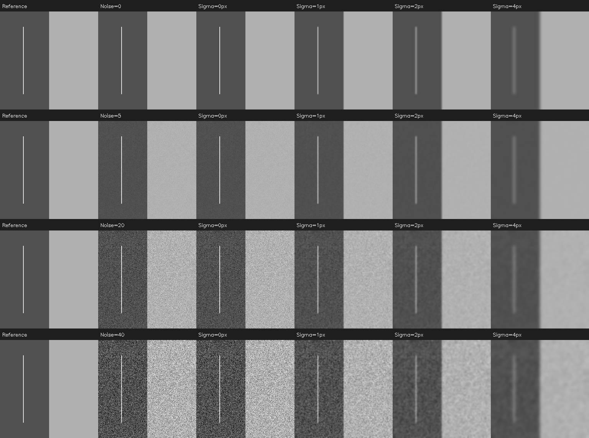

# 교육용 웹 PACS 스타터

팀원 세 명이 같은 환경에서 교육용 PACS 뷰어를 개발하기 위한 저장소다. 현재 Firebase 이메일 로그인, PNG/JPEG 열기와 확대, 원본과 연결된 케이스의 저장과 재열기를 제공한다. `intergrationOfBC`에서는 가우시안, 감마 보정과 임계값 분할의 결과, 적용 설정과 ROI 통계를 케이스에 저장하고 다시 연다.

[B와 C 통합 수동 검증 체크리스트](docs/manual-bc-checklist.md)에서 직접 누를 순서와 통과 기준을 확인할 수 있다.

## 현재 ABC의 DICOM 지원

`intergrationABC`에서는 단일 프레임 흑백 DICOM의 비압축 Little Endian, JPEG 2000 Lossless, JPEG 2000과 RLE Lossless를 지원한다. JPEG Baseline과 JPEG-LS, 컬러 및 다중 프레임은 아직 지원하지 않는다. 파일은 20MB 이하이며 압축 원본의 바이트와 해시를 그대로 보관한다. JPEG 2000 `.91`은 손실 압축을 포함하므로 무손실로 간주하지 않는다.

의존성은 `uv sync --locked`로 설치하고 실행 중인 Streamlit은 재시작한다. [지원 조건과 검사 방법](docs/image-processing/dicom-input.md), [ABC 화면과 검증 기록](docs/patient-study-ui.md)을 참고한다. 발급 주체가 없는 입력은 정상 등록을 차단하며 자동 기본값이나 이름으로 환자를 연결하지 않는다.

## BC 통합 기능

| 기능 | 현재 동작 |
|---|---|
| 영상 처리 | 가우시안, 감마 보정, 임계값 분할을 명시적으로 적용한다. 입력값만 바꾸면 기존 결과를 다시 계산하거나 저장 설정을 바꾸지 않는다. |
| ROI | 원본 좌표의 정수 사각형을 선택하고 원본과 결과에 같은 테두리를 표시한다. 오른쪽과 아래 끝 좌표는 제외한다. |
| 통계 | Pillow L 밝기를 사용해 픽셀 수, 평균과 모집단 분산을 구한다. ROI 미선택은 통계 0과 구분한다. |
| 저장 | 원본 바이트와 결과 PNG는 개발용 PC에, 파일 참조와 설정, ROI, 통계와 메모는 Firestore에 저장한다. |
| 재열기 | 저장 결과를 읽고 알고리즘과 적용값, ROI 입력을 복원한다. 재열기만으로 알고리즘을 다시 실행하거나 버전을 추가하지 않는다. |
| 변경 이력 | 다시 저장하면 새 버전을 만들고 이전 메모, 설정과 결과 참조를 보존한다. |
| 케이스 전환 | 처리 결과나 ROI만 바뀌어도 폐기 확인을 요구한다. 같은 원본을 쓰는 다른 케이스로 전환할 때 입력란까지 갱신한다. |

### 저장과 다시 열기

1. 로그인 후 **케이스 등록과 다시 열기, 변경 이력**을 열고 **케이스용 개발 저장소 사용**을 체크한다.
2. **새 케이스 작성**으로 전환한다. 저장 전 변경이 있으면 현재 내용을 보관하고 폐기 여부를 결정한다. 전환하면 현재 처리 상태가 초기화된다.
3. 합성 예시 또는 PNG/JPEG 파일을 연다.
4. 알고리즘과 설정을 고르고 해당 **적용** 버튼을 누른다.
5. ROI를 사용할 경우 네 좌표를 입력하고 **ROI 적용**을 누른다.
6. 제목, 메모와 원본 출처를 입력하고 **원본과 케이스 저장**을 누른다.
7. **저장본 다시 열기** 또는 **내 케이스 목록 불러오기 → 해당 케이스의 열기**로 복원을 확인한다.

목록은 **내 케이스 목록 불러오기**로 갱신한다. 별도의 "목록 갱신" 버튼은 없다.
저장 전 입력값과 저장 당시 적용값을 구분해야 한다. 원본을 바꾸려면 새 케이스로
작성하며 기존 케이스의 원본 참조를 변경하지 않는다.

### 검증 상태

2026년 11월 17일 기준 전체 자동 테스트 **148개**, 이 중 BC 통합 테스트 **13개**가
통과했다. `uv run --locked python -m unittest discover -v`로 전체를,
`uv run --locked python -m unittest test_bc_integration -v`로 통합 테스트를 실행한다.
자동 테스트는 실제 알고리즘과 임시 파일을 사용하고 Firestore 응답은 모의 구현으로 대체한다.

실제 브라우저에서는 저장과 재로그인 후 복원, 미적용 설정의 저장 제외, 버전별 메모와
결과 참조 보존, ROI 변경과 해제, 저장 전 변경 보호를 확인했다. 같은 합성 원본을 쓰는
두 케이스를 왕복하며 아래 입력과 통계가 각자의 값으로 복원되는 것도 확인했다.

| 케이스 | 가우시안 강도 | ROI | 픽셀 수 |
|---|---:|---|---:|
| BC 수동 검증 001 | 3.0 | (0, 0, 640, 480) | 307,200 |
| BC 수동 검증 002 | 1.0 | (20, 20, 100, 100) | 6,400 |

현재 통합본의 확대와 이동, 감마와 임계값의 수동 저장 시험, 잘못된 ROI 복구,
두 창 충돌 재시험, 서버 재시작과 다른 계정 격리는 수동 확인이 남아 있다.
실제 보안 규칙의 접근 거절과 JCloud 영구 보존은 자동 테스트 통과로 증명하지 않는다.

- [수동 검증 체크리스트와 진행 상태](docs/manual-bc-checklist.md)
- [검증 사진이 포함된 PR 본문](docs/bc-integration-pr.md)
- [저장 계약과 복원 방식](docs/case-processing.md)
- [검증 사진 원본](docs/integration-checks/bc)

먼저 앱을 실행하려면 아래 1~3번을 따른다. 가우시안 결과만 확인하려면 [담당 B 실행 방법](#담당-b-가우시안-실험-실행하기)으로 이동한다. 실험에는 Firebase 로그인이나 `.env`가 필요 없다.

## 1. 내 PC에서 앱 열기

Bash와 Windows PowerShell에서 사용할 수 있는 명령을 안내한다. 먼저 `uv --version`으로 `uv`가 설치되어 있는지 확인한다. 설치가 필요하면 공식 안내를 따른다. [uv 설치 안내](https://docs.astral.sh/uv/getting-started/installation/)

1. PACS 폴더에서 개발 환경 준비. `uv sync --locked`
2. 앱 실행. `uv run --locked streamlit run app.py`

브라우저가 자동으로 열리지 않으면 터미널에 나온 `Local URL`을 연다. Firebase를 처음 연결하는 중이라면 **교육용 PACS** 화면에 환경 변수 설정 안내가 뜬다.

`uv`는 프로젝트의 기본 Python 버전인 3.12로 `.venv`를 준비하고, `uv.lock`에 기록된 버전으로 패키지를 설치한다. 새 터미널에서도 PACS 폴더에서 `uv run`으로 앱을 실행한다. Windows PowerShell에서 Firebase를 설정할 때는 [PowerShell에서 실행하기](#powershell에서-실행하기)를 참고한다.

## 2. 팀 개발용 Firebase 준비하기

팀 프로젝트와 테스트 계정이 이미 준비되어 있다면 웹 API 키, 프로젝트 ID, 본인 테스트 계정 정보를 받아 3번으로 넘어간다. 팀 프로젝트를 처음 준비할 때는 Firebase 콘솔에서 다음 순서로 진행한다.

1. 팀 개발용 프로젝트의 **Authentication**에서 **이메일/비밀번호** 로그인을 켜고 팀 테스트 계정을 추가한다.
2. 같은 프로젝트에서 Cloud Firestore 기본 데이터베이스 `(default)`를 만들고 [firestore.rules](firestore.rules)의 읽기 규칙을 적용한다. 기존 데이터가 있는 프로젝트라면 현재 규칙과 함께 검토한다.
3. Authentication의 사용자 목록에서 테스트 계정의 UID를 복사한다. Firestore에서 `starter_checks` 컬렉션을 열고, 복사한 UID를 문서 ID로 사용해 확인 문서를 만든다. 필드 `status`에는 문자열 값 `"ready"`를 넣는다. 테스트 계정마다 문서를 하나씩 만든다.

## 3. 환경 변수 설정하고 다시 실행하기

### .env를 사용하는 방법

매번 환경 변수를 입력하지 않으려면 PACS 최상단 폴더에 `.env` 파일을 만들고 다음 두 항목을 각각 한 줄에 입력한다. 예시 문구는 본인의 실제 값으로 바꾼다.

- `PACS_FIREBASE_API_KEY="여기에_웹_API_키"`
- `PACS_FIREBASE_PROJECT_ID="여기에_프로젝트_ID"`

실행 명령은 `uv run --locked --env-file .env streamlit run app.py`다. `uv`가 `.env`를 읽어 실행하는 방식이므로 `--env-file .env`를 포함한다. 앱을 이미 실행 중이라면 `Ctrl+C`로 종료한 뒤 다시 실행한다. `.env`를 GitHub에 올리지 않는다.

Windows의 Git Bash에서 `uv: command not found`가 나오고 기존 설치 경로가 아래와 같다면 `"/c/Users/admin/AppData/Roaming/Python/Scripts/uv.exe" run --locked --env-file .env streamlit run app.py`로 실행할 수 있다. 이 경로의 `admin`은 PC 사용자 이름이므로 다른 팀원은 본인의 설치 경로를 확인한다.

### 터미널에서 직접 설정하는 방법

**두 값을 설정한 터미널에서 앱을 실행한다.** 아래 방식은 `.env` 대신 현재 터미널에 값을 설정할 때 사용한다.

Firebase 콘솔의 **프로젝트 설정 → 일반 → 내 앱**에서 웹 앱을 선택하고 **구성(Config)**을 연다. 웹 앱이 없으면 **프로젝트 개요**의 웹 아이콘으로 등록한다. 구성에 나온 `apiKey`와 `projectId`를 복사하고, 아래 따옴표 안의 예시 문구를 실제 값으로 바꿔 입력한다. [Firebase 콘솔에서 웹 앱 구성 찾기](https://firebase.google.com/docs/projects/api-keys), [웹 앱 등록하기](https://firebase.google.com/docs/web/setup)

1. 웹 API 키 설정. `export PACS_FIREBASE_API_KEY="여기에_웹_API_키"`
2. 프로젝트 ID 설정. `export PACS_FIREBASE_PROJECT_ID="여기에_프로젝트_ID"`
3. 앱 다시 실행. `uv run --locked streamlit run app.py`

새 터미널을 열면 두 값을 다시 `export`한 뒤 앱을 실행한다.

브라우저에서 팀 테스트 계정으로 로그인한 뒤 **Firestore 연결 확인**을 누른다. “Firestore에서 내 확인용 문서를 읽었습니다.”라는 메시지가 뜨면 연결된 상태다. 앱은 로그인한 사용자의 ID 토큰으로 본인 확인 문서를 읽는다. 세션이 만료되면 다시 로그인한다.

### 연결이 안 될 때

| 화면에 보이는 내용 | 확인할 곳 |
| --- | --- |
| 환경 변수 설정 안내가 계속 뜬다 | 두 값의 이름을 확인한다. 두 값을 입력한 터미널에서 앱을 다시 실행한다. |
| 로그인에 실패했습니다 | 테스트 계정의 이메일과 비밀번호, 이메일/비밀번호 로그인 설정, 웹 API 키를 확인한다. |
| Firestore 접근이 거절됐습니다 | 웹 API 키와 프로젝트 ID가 같은 프로젝트의 값인지, Firestore에 읽기 규칙을 적용했는지 확인한다. |
| Firestore 데이터베이스 또는 내 확인용 문서가 없습니다 | `(default)` 데이터베이스에 `starter_checks` 컬렉션이 있고, 문서 ID가 로그인한 계정의 UID와 같은지 확인한다. |

앱 연결에는 웹 API 키와 프로젝트 ID를 쓴다. 계정 비밀번호, 사용자 토큰, 서비스 계정 키와 실제 환자 자료는 GitHub에 올리지 않는다.

## PowerShell에서 실행하기

개발 환경을 준비하는 명령은 1번과 같다. Firebase 환경 변수는 아래 방식으로 설정한다.

1. 웹 API 키 설정. `$env:PACS_FIREBASE_API_KEY = "여기에_웹_API_키"`
2. 프로젝트 ID 설정. `$env:PACS_FIREBASE_PROJECT_ID = "여기에_프로젝트_ID"`
3. 같은 터미널에서 앱 실행. `uv run --locked streamlit run app.py`

## 팀 작업 시작하기

- [app.py](app.py)에는 화면과 로그인 흐름이 있다. [firebase_client.py](firebase_client.py)는 Firebase 로그인과 Firestore 읽기 요청을 보내고, [firestore.rules](firestore.rules)는 본인 확인 문서 읽기를 허용한다.
- `uv run --locked python -m unittest discover -v`로 [단위 테스트](test_firebase_client.py)를 실행한다. 테스트는 네트워크 응답을 흉내 내므로 Firebase 계정 없이 실행할 수 있다.
- 팀 개발용 Firebase에서는 정상 로그인, 잘못된 비밀번호, 본인 문서 조회, 다른 사용자 문서 조회 거절과 로그아웃을 확인한다.
- 팀원마다 GitHub Issue와 작업 브랜치를 정한다. 뷰어, 영상처리, 케이스와 검토 기능의 첫 작업을 나눈다. 웹 템플릿은 팀 회의에서 고르고, 역할별 접근 권한과 실제 데이터 모델은 팀 설계에 맞춰 추가한다.
- 뷰어는 영상 파일 열기, 원본 표시, 확대와 초기화, 같은 영상의 처리 전후 비교 순으로 만든다.

## 뷰어 스타터 (feature/viewer-starter)

로그인 뒤 왼쪽에서 PNG/JPEG 파일 또는 합성 예시를 선택한다. 중앙에서 원본을
확대하고 가로와 세로 위치를 조절하며, 오른쪽에서 파일 형식, 크기, 영상 ID와 표시
상태를 확인한다. 확대는 원본의 일부를 잘라 같은 화면 크기로 보여주는 방식이다.
보기 초기화 또는 다른 파일 선택 시 전체 영상으로 돌아온다. 원본 파일은 수정하지 않는다.

- 지원: 단일 프레임 PNG/JPEG, 20 MB 이하, 2,000만 픽셀 이하, 8비트 표시 영상.
- 미지원: DICOM/CT 시리즈, 16비트 정량 분석, MPR, 3D, 실제 단위 측정,
  운영용 영상 저장소와 AI. 케이스 목록과 개발용 원본 저장은 아래 C 영역에서 제공한다.
  CT 예시를 사용한다면 PNG/JPEG로 내보낸 2D 단면이다.
- 확장자뿐 아니라 실제 형식과 디코딩을 검사한다. 손상 파일, 다른 형식, 제한 초과는
  이유를 표시한다. PNG는 디코딩 전에 IHDR 헤더의 채널당 비트 깊이를 확인하여
  16비트 회색조, RGB, RGBA 영상을 거절한다. Pillow가 표시하는 RGB/RGBA 모드만으로
  비트 깊이를 판단하지 않는다. JPEG 방향 정보는 화면에 반영한다.
- 시안의 영상 선택/중앙 뷰어/정보 패널 배치를 참고했다. 처리 결과가 없을 때
  원본을 처리 결과라고 표시하지 않는다. PACS 연결, 저장 완료를 가정하지 않는다.
- 합성 예시는 코드에서 생성한 명암/사각형 패턴으로, 환자 자료나 외부 영상이 아니다.
- 로그아웃, 세션 만료 시 뷰어 상태를 지운다. 새로고침 시 파일이 유지되는 것을
  보장하지 않으며, Firebase에는 이 단계의 영상이나 처리 결과를 저장하지 않는다.

### 영상처리 담당 연결 지점

`viewer.py`의 `render_viewer(processor=None)`에 함수를 전달한다. 함수는 현재 원본의
**RGB PIL 이미지 복사본**을 받고, 같은 크기의 PIL 이미지를 반환한다. 가로와 세로 위치와
확대는 두 영상에 동일하게 적용한다. 결과 크기가 다르거나 처리에 실패하면 오류를
표시하고 원본을 유지한다. 콜백의 호출 시점과 처리 이력 저장 시점은 통합 단계에서 합의한다.

`render_viewer` 반환값은 `ViewerSource | None`이다. 영상 선택 시 `source_id`(파일 내용의
SHA-256), `name`, `file_format`, `byte_count`, `image`를 제공한다. 처리 이력과 ROI 연결은
이 ID와 원본 픽셀 좌표를 기준으로 합의한다. 처리 함수가 원본 크기나 좌표를 바꾸려면
현재 계약과 표시 로직을 함께 수정해야 한다.

### 첫 확인 순서

1. 로그인 → 합성 예시 선택 → 중앙 원본과 오른쪽 정보 확인.
2. 확대 2배 → 가로와 세로 위치 변경 → 보기 초기화.
3. 정상 PNG와 JPEG 선택 → 파일 이름과 픽셀 크기 확인.
4. 손상 PNG 선택 → 이전 영상 대신 오류 안내 확인.
5. 새 영상 선택 → 확대와 위치가 기본값으로 돌아오는지 확인.
6. 로그아웃 → 로그인 화면으로 돌아오는지 확인.

자동 확인: `uv run --locked python -m unittest discover -v`.
파일 검증, 방향, 확대 좌표, 화면 초기화, 처리 함수의 원본 보존과 결과 크기,
로그아웃을 Firebase 네트워크 없이 검사한다. 실제 계정 로그인과 파일 선택은 별도로 확인한다.

### 브랜치 작업과 리뷰

`develop`에서 `feature/viewer-starter`를 만들고 이 브랜치에서 작업한다.
커밋/푸시 뒤 GitHub에서 **base: develop / compare: feature/viewer-starter**로 PR을 만든다.
팀원 리뷰 후 합친다. `/`는 이름을 구분하는 관례이며 별도 프로젝트 폴더가 아니다.

## 담당 C 첫 단계: 본인 케이스 초안

로그인 후 **케이스 초안 저장과 조회**를 열면 제목과 메모를 Firestore에 저장하고
본인 초안을 다시 읽을 수 있다. 이 단계는 메타데이터 초안이다. 영상 파일, 처리 결과,
ROI, 검토자 배정과 검토 상태는 아직 저장하지 않는다. 원본 영구 저장과 역할 정책은
후속 작업에서 연결한다. 기존 뷰어와 processor 계약은 유지했다.

### 먼저 적용할 규칙

팀 개발용 Firebase 콘솔의 Firestore 규칙에서 현재 게시 규칙과 이 저장소의
firestore.rules를 비교한 뒤 새 case_drafts 규칙을 함께 게시한다. 다른 팀원이 추가한
규칙이 있다면 삭제하지 말고 먼저 합의한다. 로컬 파일 수정만으로 클라우드 규칙이
바뀌지는 않는다. 이 변경은 콘솔에 자동 게시하지 않는다.

경로는 users/{로그인 UID}/case_drafts/{초안 ID}다. 본인 경로만 읽기/생성을 허용하고,
초안 수정과 삭제는 허용하지 않는다. 역할 공유와 실제 케이스 데이터 모델이 확정되면
이 메타데이터 초안과 영상이 연결된 케이스를 구분해 설계한다.

저장 필드는 owner_uid, title, note, stage, version, created_at이다. stage의 문자열
값은 "metadata_only", version은 정수 1이며 created_at은 서버 시각이다. 제목은
앞뒤 공백을 뺀 1~120자, 메모는 4,000자 이하로 제한한다.

### 사용 순서

1. 로그인하고 케이스 초안 영역을 연다.
2. 가상 케이스 제목과 메모를 입력한 뒤 제목과 메모 저장을 누른다.
3. 실패하면 같은 저장 요청 재시도를 누른다. 동일 ID와 내용을 재사용하며, 기존
   초안에 다른 내용이 있으면 덮어쓰지 않는다. 재시도 중에는 요청 내용을 고정한다.
4. 성공 후 새 초안 작성을 누르면 다음 초안을 입력할 수 있다.
5. 내 초안 목록 불러오기를 누르면 본인 문서를 50개씩 읽는다. 다음 페이지가 있으면
   다음 초안 불러오기 버튼이 나온다. 제목 검색은 현재 불러온 목록 안에서만 수행한다.
6. 새로고침/재로그인 후 다시 목록을 불러와 제목과 메모를 확인한다. 목록은 자동으로
   클라우드를 조회하지 않으며 저장 후 목록을 갱신할 때도 불러오기 버튼을 누른다.

저장 요청 ID는 현재 로그인 세션에 유지한다. 요청에 실패했다가 재시도하면 중복
생성을 방지하지만, 브라우저 세션을 잃고 새로 작성하면 별도 초안이다. 작성 중인
입력과 목록은 로그아웃/세션 만료/인증 거절 시 지운다. 서버에 저장한 초안은 남는다.

### 검증과 남은 범위

test_cases.py는 생성 전제조건, 서버 시각 요청, 입력 검사, 재시도/충돌, 목록 페이지,
조회 오류와 빈 목록 구분, 세션 정리를 모의 응답과 Streamlit AppTest로 확인한다.
이 테스트는 실제 Firestore 보안 규칙이 강제되는 것을 증명하지 않는다.

실제 규칙 게시 후에는 다음을 별도로 확인해야 한다.

- 사용자 A의 제목/메모 저장과 재로그인 후 조회.
- 사용자 B와 비로그인 요청의 A 경로 읽기/생성 거절.
- owner_uid 위조, 추가 필드, 임의 생성 시각, 긴 제목/메모 거절.
- 저장된 초안 수정/삭제 거절과 기존 starter_checks 읽기 유지.

실제 환자 자료나 비밀번호를 시험 메모에 입력하지 않는다. 영상 재열기, 처리 기록,
동시 메모 수정, 검토자 권한과 JCloud 파일 보존은 이 첫 단계의 완료 범위가 아니다.

## 담당 C 추가 단계: 원본과 연결된 케이스

위의 첫 단계 설명은 기존 메타데이터 초안 기능에 해당한다. 새 기능은 로그인 후
**케이스 등록과 다시 열기, 변경 이력**에서 사용한다. 기존 초안을 삭제하거나 새
케이스로 자동 변환하지 않는다. 반드시 C 명세의 확정된 범위만 구현한다.
등록자와 검토자 구분, 배정, 검토 요청과 완료 전이는 합의 전이므로 구현하지 않았다.

### 이번에 연결한 기능

- 원본 파일과 제목, 메모, 출처를 하나의 본인 케이스로 연결한다.
- 원본은 기존 개발용 로컬 저장소에 바이트 그대로 보존한다. Firestore에는
  영상 바이트 대신 사용자 UID, 파일 참조, 해시, 크기, 출처와 메모를 저장한다.
- 목록은 본인 경로에서 50건씩 읽는다. 검색 범위는 불러온 목록의 제목과 ID다.
- 다시 열 때 로그인 UID와 파일 해시, 크기를 확인하고 기존 뷰어로 연결한다.
- 제목과 메모, 출처를 수정하면 현재 문서와 변경 이력을 한 번에 저장한다.
  현재 문서의 서버 수정 시각을 조건으로 쓰므로 오래된 화면의 수정은 덮어쓰지 않는다.
- 같은 저장 요청을 재시도하면 고정된 ID와 입력을 사용한다. 서버 응답이 유실됐으면
  변경 이력에서 동일 요청이 이미 저장됐는지 확인한다.
- 저장 전 입력이나 실패한 요청이 있으면 케이스를 바꾸기 전에 폐기 확인을 요구한다.
  충돌 시에는 현재 입력을 복사해 두고 최신 저장본을 다시 열어 비교한다.
- 기존 처리 기록은 메모만 수정해도 보존한다. B가 전달한 ProcessingRecord의
  원본 해시, 알고리즘 ID와 버전, 설정, 같은 크기의 RGB 결과, 원본 좌표 ROI와 통계를
  검증하고 저장하거나 다시 읽는다. 저장본을 열면 B 입력란도 복원하고,
  다시 적용한 결과는 새 버전으로 저장한다. 자세한 계약과 검증 범위는
  [처리 기록 저장과 복원](docs/case-processing.md)을 참고한다.

### 직접 확인하는 순서

1. 합성 예시를 선택하고 새 케이스 영역에서 케이스용 개발 저장소 사용을 선택한다.
2. 제목, 메모, 원본 출처와 사용 허용 근거를 입력하고 원본과 케이스 저장을 누른다.
3. 성공하면 저장본 다시 열기를 눌러 같은 원본과 입력이 나오는지 확인한다.
4. 메모를 바꾸어 저장한 뒤 저장본을 다시 열고 변경 이력에서 이전 메모를 확인한다.
5. 두 브라우저에서 같은 케이스를 열고 각각 수정한다. 두 번째 저장은 충돌 안내가
   나와야 한다. 입력을 보관한 뒤 최신 버전을 다시 열어 비교한다.
6. 메모를 입력한 상태에서 다른 케이스를 열면 전환이 보류되어야 한다.
7. 로그아웃과 재로그인 후 내 케이스 목록을 불러와 다시 연다.

Firestore 규칙은 자동 게시하지 않으며 팀 프로젝트의 게시 상태는 별도로 확인한다. 규칙 적용 전
접근 거절은 예상되는 상태다. 파일 저장 뒤 Firestore 요청이 실패하면 전체 성공으로
표시하지 않으며, 원본은 지우지 않고 같은 요청 재시도를 제공한다. 저장 대기 중에는
요청 내용이 고정되며 수정하려면 현재 입력을 보관하고 새 작성 또는 다시 열기를 선택한다.
실패한 요청과 입력은 브라우저 세션을 잃으면 복구되지 않을 수 있다.

### 데이터와 검증 범위

경로는 users/{UID}/cases/{case_id}, 변경 이력은 그 아래 versions/{operation_id}다.
본인만 읽기와 쓰기가 가능하도록 규칙을 작성했으며 상태는 "draft" 하나만 허용한다.
변경 이력 수정과 삭제, 원본 참조 변경은 허용하지 않는다. 서버 시각 saved_at과
기준 updateTime을 사용한다. 등록 시각은 버전 1의 saved_at이며 목록에는 현재 버전의
저장 시각을 표시한다. 기존 starter_checks와 case_drafts 규칙은 보존했다.

test_case_records.py는 저장과 재열기, 동일 요청 재시도, 수정 충돌과 이력 보존,
원본과 ROI 검사, 처리 기록 유지, 다른 UID 거절, 손상 파일 거절, 저장 실패,
페이지 조회와 입력 폐기 확인을 모의 요청과 Streamlit AppTest로 확인한다.
실제 Firestore 규칙의 문법과 강제 적용은 에뮬레이터 또는 규칙 게시 후 별도로
검증해야 한다. 사용자 A와 B, 비로그인 접근, owner_uid 위조, 임의 버전과 추가 필드,
이력 수정과 삭제 거절, 정상적인 두 문서 동시 저장을 실제 요청으로 확인해야 한다.

개발 파일 저장소는 이 앱을 실행하는 PC의 디스크다. 다른 PC나 다중 서버에 자동
공유되지 않으며 JCloud 재배포 후 보존을 보장하지 않는다. 파일 존재와 해시는 앱에서
검사하며 Firestore 규칙 자체가 로컬 파일의 존재를 확인하는 것은 아니다.
운영 저장소와 두 역할의 정책이 확정되기 전까지 C 전체 완료나 운영 배포 완료로
판정하지 않는다. 실제 환자 자료로 시험하지 않는다.

## 담당 B: 가우시안 실험 실행하기

현재 `image_processing.py`와 `experiments/gaussian_experiment.py`는 NumPy와 OpenCV를 사용한다. 처리 함수는 기존 RGB PIL 이미지를 입력받고 같은 크기의 새 RGB PIL 이미지를 반환한다. 원본 픽셀과 A, C 담당이 사용할 입출력 계약을 유지한다.

### 준비와 실행

아래 명령은 모두 PACS 최상단 폴더에서 실행한다. 의존성이 바뀌었으므로 처음에는 `uv sync --locked`로 환경을 맞춘다.

1. 합성 도형 실험: `uv run --locked python experiments/gaussian_experiment.py`
2. Lenna 컬러 실험: `uv run --locked python experiments/gaussian_experiment.py --input "./experiments/Lenna.png" --color-mode color`
3. 같은 입력의 흑백 실험: `uv run --locked python experiments/gaussian_experiment.py --input "./experiments/Lenna.png" --color-mode grayscale`
4. 옵션 확인: `uv run --locked python experiments/gaussian_experiment.py --help`

프로젝트 환경을 이미 활성화했다면 앞의 `uv run --locked python` 대신 `python`을 사용해도 된다. 예를 들어 `python experiments/gaussian_experiment.py --input "./experiments/Lenna.png"`는 Lenna 컬러 실험이다. 입력 경로를 생략하면 합성 도형 실험으로 실행된다. `--input` 뒤의 파일이 실제로 있어야 하며 다른 영상을 쓰려면 그 경로로 바꾼다.

### 결과 확인

- 합성 도형: [비교 이미지](docs/image-processing/results/gaussian-opencv/synthetic/comparison.png), [측정값](docs/image-processing/results/gaussian-opencv/synthetic/summary.md).
- 현재 저장된 Lenna 컬러: [비교 이미지](docs/image-processing/results/gaussian-opencv/external-color/comparison.png), [측정값](docs/image-processing/results/gaussian-opencv/external-color/summary.md).
- 흑백 외부 입력의 기본 출력 폴더는 `docs/image-processing/results/gaussian-opencv/external-grayscale`다. 해당 명령을 실행하면 생성된다.
- [결과 폴더 안내](docs/image-processing/results/README.md)에서 파일별 용도와 비교 이미지 읽는 방법을 확인한다.
- [가우시안 구현과 실험 설명](docs/image-processing/gaussian.md)에서 함수 계약, 계산 기준과 A, B, C 연결 범위를 확인한다.

같은 출력 폴더로 다시 실행하면 동일한 이름의 결과 파일을 덮어쓴다. 다른 실험을 보관하려면 명령 끝에 `--output ".local-data/gaussian-lenna-test"`처럼 별도 경로를 지정한다. 이 개발용 경로는 팀 공유 결과 폴더와 구분해 사용한다.

비교 이미지의 행은 위에서부터 잡음 강도 0, 5, 20, 40이다. 열은 왼쪽부터 기준 영상, 잡음 입력, 처리 강도 0, 1, 2, 4다. 아래로 내려가며 잡음을 비교하고, 같은 행에서 오른쪽으로 이동하며 잡음 감소와 세부 구조 손실을 함께 확인한다. 잡음 추가는 필터 검증용 입력을 만드는 과정이며 AI 학습을 실행하는 기능은 아니다.

### 실행 결과 사진

아래 사진은 현재 저장된 독립 실험 결과다. 웹사이트 화면을 캡처한 사진은 아니다.

#### 합성 도형

같은 행에서 오른쪽으로 이동하며 잡음 감소와 경계 및 얇은 선의 흐려짐을 함께 확인한다.

#### Lenna 컬러

같은 잡음 입력에 가우시안 강도를 바꿨을 때 색상과 세부 구조가 어떻게 달라지는지 확인한다.

두 사진 모두 위에서부터 잡음 강도 0, 5, 20, 40이다. 왼쪽부터 기준 영상, 잡음 입력, 필터 강도 0, 1, 2, 4다. 잡음 강도의 단위는 8비트 밝기값이고 필터 강도의 단위는 원본 픽셀이다. 각 영상 칸은 256×256이며, 두 비교판은 같은 크기와 조건 순서를 사용한다.

### 앱 통합과 구분할 점

현재 `app.py`는 가우시안 처리 함수를 기존 뷰어의 processor에 전달한다.
영상을 연 뒤 왼쪽에서 강도(0~20, 원본 픽셀 표준편차)를 정하고 **가우시안 적용**을 누르면
오른쪽에 결과와 실제 적용 설정을 표시한다. 설정만 바꾸면 재계산하지 않는다.
실패 시 이전 결과를 지우고, 영상 교체/로그아웃 시 처리 상태를 정리한다.
[웹 연결 사용법과 검증 상태](docs/image-processing/gaussian-web.md)를 참고한다.
C의 처리 기록 저장 연결은 위 BC 통합에 포함한다. DICOM은 후속 작업이다.

### P02: ROI 좌표와 밝기 통계

영상을 연 뒤 왼쪽 **ROI 영역**에서 원본 픽셀 좌표 left/top/right/bottom을
입력하고 **ROI 적용**을 누른다. 오른쪽과 아래 끝은 제외하며 잘못된 좌표를
자동으로 자르지 않는다. 두 비교 창의 노란 테두리가 같은 원본 영역을 표시한다.
아래 **ROI 밝기 통계**에서 픽셀 수, 평균과 모집단 분산을 비교한다.
처리 결과가 없으면 원본 통계만 표시한다. 확대·이동은 통계에 영향을 주지 않는다.
**ROI 해제**, 영상 교체와 로그아웃으로 선택 상태를 정리한다.
[계산 기준, 함수 계약과 C 전달 형식](docs/image-processing/roi.md)을 참고한다.

같은 ROI에서 잡음·가우시안 강도의 영향을 비교하려면
`uv run --locked python experiments/roi_experiment.py`를 실행한다.
[고정 ROI 실험 결과](docs/image-processing/results/roi-gaussian/summary.md)는
평탄부·경계·얇은 선의 좌표/크기와 원본·결과 평균/모집단 분산을 기록한다.
같은 출력 폴더의 파일을 덮어쓰므로 별도로 보관하려면 `--output .local-data/roi-test`를 지정한다.

## JCloud 배포

배포 대상은 전북대학교 JCloud다. 학교의 배포 지침을 받으면 실행 환경, 환경 변수 등록과 HTTPS 접속 설정을 확인하고 이 문서에 실제 절차를 추가한다.

## 공식 참고 자료

담당 B의 실행 방법과 내부 계약은 위의 가우시안 안내에서 확인한다. 아래 자료는 저장소에서 기존에 참고하던 공식 문서다.

- [Streamlit 실행 안내](https://docs.streamlit.io/get-started/fundamentals/main-concepts)
- [Firebase Authentication 이메일 로그인 API](https://firebase.google.com/docs/reference/rest/auth#section-sign-in-email-password)
- [Cloud Firestore REST API와 보안 규칙](https://firebase.google.com/docs/firestore/use-rest-api)
