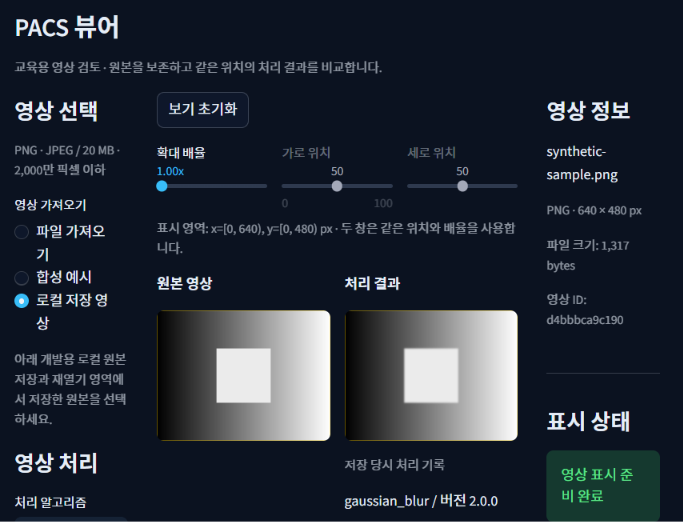
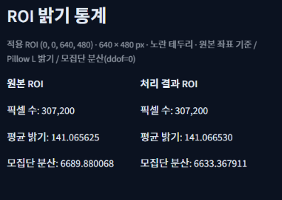
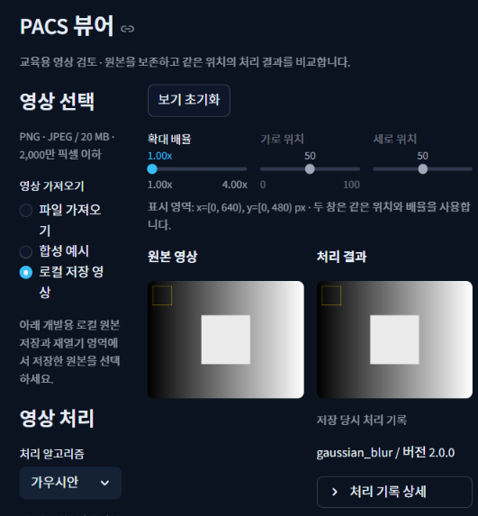
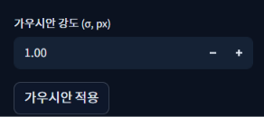
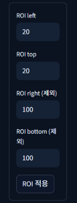
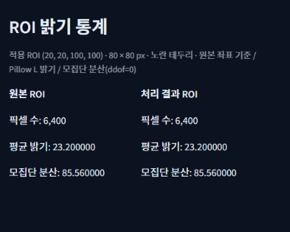
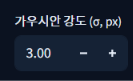
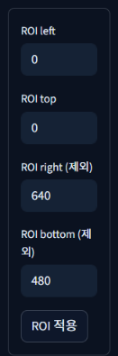

# BC 통합: 처리 결과 저장과 복원 연결 및 케이스 전환 오류 수정

B에서 적용한 처리 결과와 ROI 통계를 C의 케이스 저장 기능에 연결했습니다.
저장본을 열면 이미지뿐 아니라 알고리즘과 적용값, ROI 입력란도 함께 복원됩니다.

## 변경 내용

- 현재 표시한 결과와 실제 적용 설정을 `ProcessingRecord`로 전달합니다. 적용하지 않은 입력값은 저장하지 않습니다.
- 저장본을 연 뒤 새로 처리한 결과를 저장할 수 있도록 결과 표시 우선순위를 수정했습니다.
- ROI 변경과 해제를 저장하고, 메모만 수정할 때는 기존 처리 기록을 보존합니다.
- 처리 결과나 ROI만 바뀌어도 폐기 확인 없이 케이스를 전환하지 않도록 보완했습니다.
- 같은 원본의 다른 케이스를 열 때 알고리즘과 설정, ROI 입력 네 칸을 브라우저에 명시적으로 갱신합니다. 기본값과 Session State 중복 경고도 함께 해결했습니다.
- 처리 기록의 전체 JSON을 기본으로 접고, 중복 `ImageDraw` import를 제거했습니다.

## 검증

전체 자동 테스트 **148개**가 통과했으며, BC 통합 테스트 **13개**를 포함합니다.
자동 테스트는 실제 B 알고리즘과 임시 파일 저장, Streamlit AppTest와 모의 Firestore를 사용했습니다.
케이스 전환 시험에서는 내부 값뿐 아니라 브라우저 위젯에 새 값을 보내는지도 확인했습니다.

실제 브라우저에서 확인한 항목입니다.

- [x] 처리 결과와 ROI 저장, 재로그인 후 복원
- [x] 미적용 설정의 저장 제외
- [x] 메모 수정과 재처리 후 이전 버전 보존
- [x] ROI 변경과 해제의 저장과 복원
- [x] 처리 변경, ROI 변경과 ROI 해제 시 저장 전 변경 보호
- [x] 폐기 확인 후 새 케이스 전환과 기존 저장본 보존
- [x] 같은 원본의 두 케이스를 왕복할 때 입력란과 결과, ROI 통계 복원

## 검증 사진

같은 합성 원본을 사용했습니다. 영상 ID는 같고 케이스 ID는 서로 다릅니다.

| 케이스 | 가우시안 | ROI | 픽셀 수 |
|---|---:|---|---:|
| BC 수동 검증 001 | 3.0 | (0, 0, 640, 480) | 307,200 |
| BC 수동 검증 002 | 1.0 | (20, 20, 100, 100) | 6,400 |

### 001 저장본 재열기

### 002 입력과 통계 복원

### 002에서 001로 다시 전환

002의 1.0과 작은 ROI가 입력란에 남던 오류를 수정한 뒤 다시 확인했습니다.

## 남은 수동 검증

- [ ] 확대와 이동 후 ROI 통계와 저장 기록 유지
- [ ] 감마와 임계값의 저장과 복원
- [ ] 잘못된 ROI 입력의 저장 차단과 복구
- [ ] 현재 BC 통합본의 두 창 저장 충돌 재시험
- [ ] 서버 재시작 후 재열기
- [ ] 다른 계정의 데이터 격리와 비로그인 요청의 실제 접근 거절
- [ ] 실제 실패 요청의 동일 요청 재시도와 중복 방지

이전 C 단독 브랜치에서 확인한 두 창 충돌과 현재 통합본의 재시험은 구분했습니다.
실제 보안 규칙의 강제 적용과 JCloud 영구 보존은 이번 자동 테스트로 검증하지 않았습니다.
검토자 배정과 역할별 상태 전이는 현재 구현 범위에 포함하지 않았습니다.
