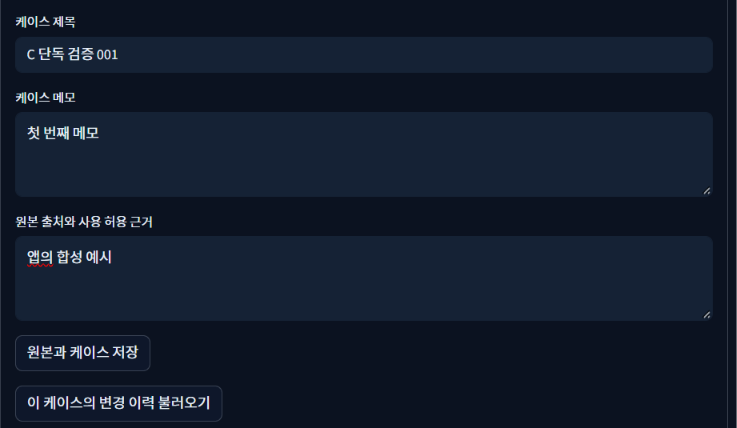
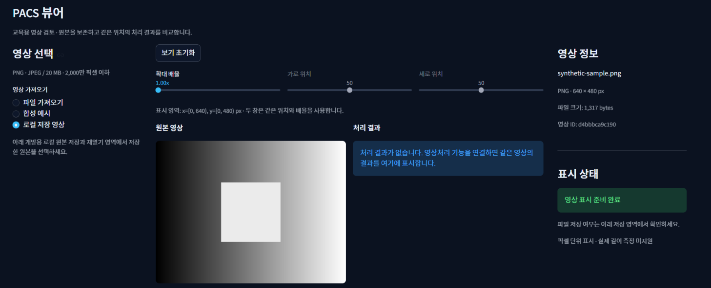
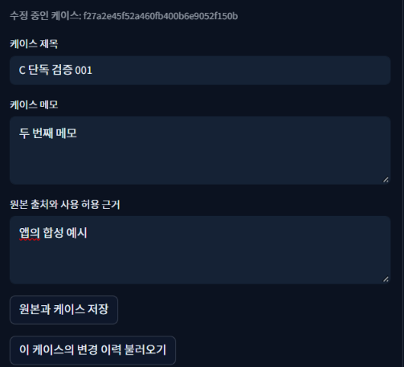
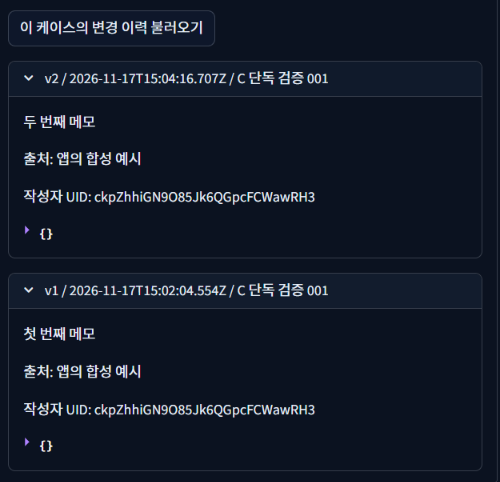
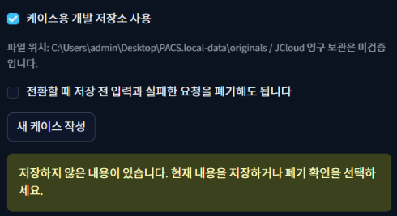
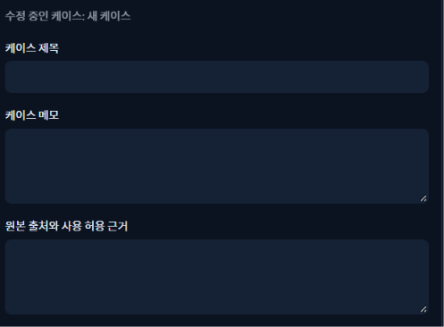
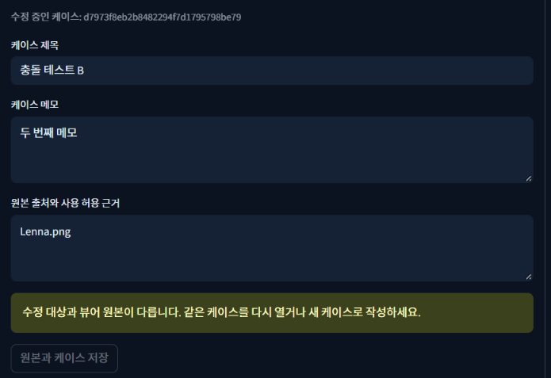
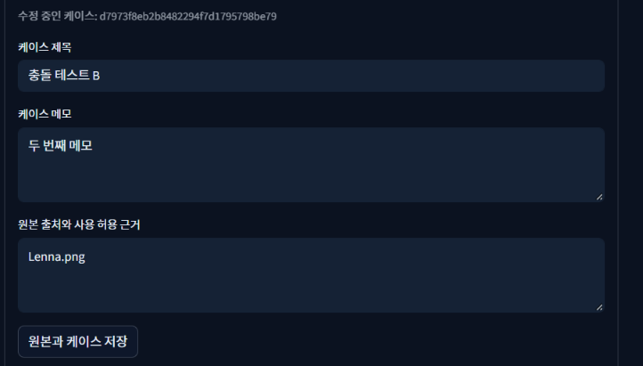

## C 단독 브랜치 보완과 검증 결과

처리 설정이나 ROI만 변경한 경우에도 저장 전 변경으로 감지하도록 보완했습니다.
수정 중인 케이스와 다른 원본을 선택하면 저장 버튼을 비활성화하고, 같은 케이스를
다시 열면 저장할 수 있도록 했습니다. 처리 기록의 전체 JSON은 기본으로 접힌
**처리 기록 상세**에서 확인할 수 있습니다.

### 확인한 내용

- 자동 테스트 **60개 통과**. 처리 기록 보존, 설정과 ROI 변경 감지, 고정된 요청 재시도,
  원본 불일치 차단과 복구를 포함합니다. 파일은 임시 디렉터리에 실제 저장하고
  Firestore 응답은 모의 구현으로 확인했습니다.
- **2026-11-18(KST)** C 단독 화면에서 아래 네 시나리오를 직접 확인했습니다.
- 이번 수동 케이스는 처리 기록이 없는 원본 저장 사례입니다. 이력의 `{}`는 정상이며,
  B 알고리즘과 ROI 계산을 수동 검증했다는 뜻은 아닙니다.

### 1. 저장 후 다시 열기

`C 단독 검증 001`을 저장한 뒤 다시 열어 제목, 첫 번째 메모와 출처가 복원되는지
확인했습니다. 원본은 `synthetic-sample.png`, 640 × 480 픽셀, 1,317바이트이며
영상 ID 앞부분은 `d4bbbca9c190`입니다.

### 2. 메모 수정과 변경 이력

메모를 `두 번째 메모`로 바꿔 저장하고 다시 열었습니다.
변경 이력에서는 v1의 `첫 번째 메모`와 v2의 `두 번째 메모`를 각각 확인했습니다.

### 3. 미저장 입력 보호와 새 케이스 초기화

메모를 수정한 채 **새 케이스 작성**을 누르면 전환을 차단했습니다.
폐기를 허용한 뒤 다시 누르면 새 케이스로 전환되고 제목, 메모와 출처가 비워졌습니다.

### 4. 원본 불일치 저장 차단과 복구

`Lenna.png`가 연결된 케이스에서 다른 원본을 선택하자 경고가 나타나고
**원본과 케이스 저장** 버튼이 비활성화됐습니다.
같은 케이스를 다시 열면 원본과 입력이 복원되고 경고가 사라지며 저장 버튼이 활성화됐습니다.

### 검증 범위

이번 결과는 C 단독 브랜치의 기본 저장 흐름과 보완 사항에 대한 확인입니다.
다른 계정과 비로그인 상태의 실제 접근 거절, 프로세스 재시작 후 복원과 JCloud 파일
보존은 이번 검증에 포함하지 않았습니다. 운영 배포 완료를 의미하지 않습니다.
