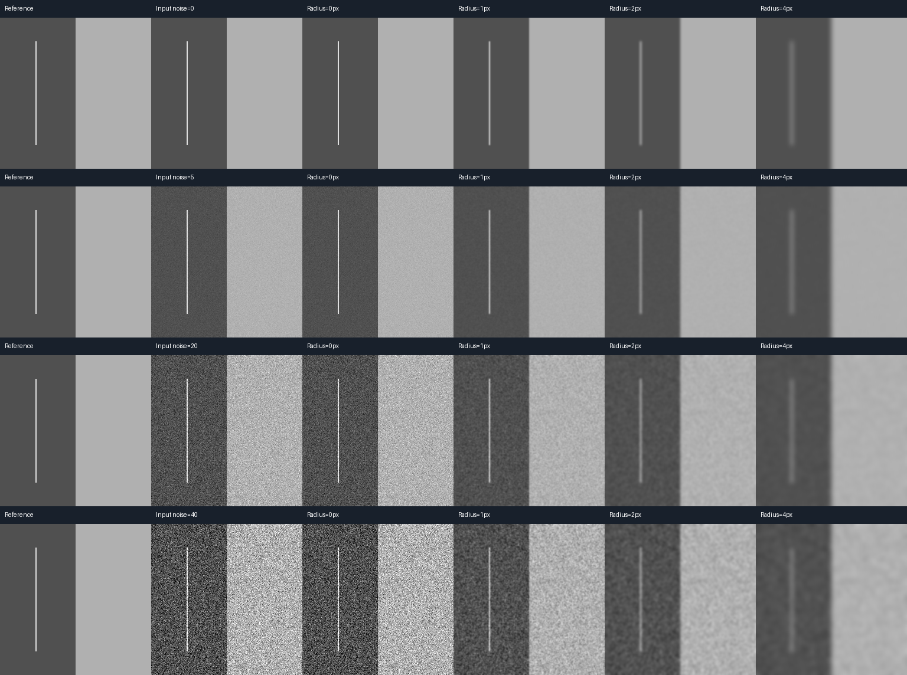

# 가우시안 블러: 구현·검증·비교 실험

## 범위와 과제 연결

담당 B의 첫 알고리즘이다. 과제의 영상처리 알고리즘 구현·매개변수 비교·결과 분석에 대한
근거를 남긴다. **가우시안 하나로 알고리즘 3개와 ROI 요구를 모두 완료한 것은 아니다.**
감마·임계값·사용자 ROI 통계 및 히스토그램은 후속 작업이다.

이번 PR은 독립 함수, 자동 테스트, 재현 가능한 합성 영상 실험을 제공한다.
실제 앱의 알고리즘 선택·강도 조절 화면과 저장 이력은 아직 연결하지 않았다.
`app.py`, `viewer.py`, Firebase 설정은 수정하지 않는다.

## 원리와 라이브러리 선택

가우시안 평활화는 가까운 픽셀에 더 큰 가중치를 주어 노이즈를 줄인다.
이론적인 2차원 가중치는 `G(x,y) ∝ exp(-(x²+y²)/(2σ²))`이며 합을 1로 정규화한다.
σ가 커지면 더 넓게 평균화하므로 작은 구조와 경계도 흐려진다.

기존 의존성인 Pillow 12.3.0의 `ImageFilter.GaussianBlur`를 사용한다.
직접 작성한 정확한 가우시안 커널 합성곱이 아니라 **확장 박스 필터를 이용한 근사**다.
Pillow에서 radius는 가우시안 표준편차 σ이며, 이 함수에서는 **원본 영상 픽셀 단위**다.
커널 한 변 길이 또는 실제 신체 길이(mm)가 아니다. 경계 처리와 반올림은 고정된 Pillow 구현을 따른다.

근거: [Pillow GaussianBlur 공식 문서](https://pillow.readthedocs.io/en/stable/reference/ImageFilter.html#PIL.ImageFilter.GaussianBlur).
라이브러리 사용 이유는 기존 환경을 유지하며 검증된 RGB 처리를 재사용하기 위해서다.

## 함수 계약

`image_processing.gaussian_blur(image, radius=1.0) -> PIL.Image.Image`

| 항목 | 동작 |
|---|---|
| 입력 | `viewer.load_image`에서 검증·EXIF 방향 보정된 비어 있지 않은 RGB 전체 영상 |
| 출력 | 같은 크기·RGB 모드의 새 이미지, 원본 불변 |
| radius | 유한 실수, 0~20 px. bool·문자열·NaN·무한대 거절 |
| radius=0 | 원본과 픽셀이 같은 독립 복사본 |
| 잘못된 입력 | TypeError 또는 ValueError, 성공 결과로 대체하지 않음 |
| 알고리즘 식별 | `gaussian_blur`, 버전 `1.0.0` |

상한 20 px와 기본값 1 px는 이번 구현의 제안이며 과제의 지정 수치가 아니다.
새 의존성은 없다. RGB 채널을 각각 처리하며 회색조로 강제 변환하지 않는다.
고비트 원본의 검증은 파일 헤더를 읽는 `load_image` 책임이다. 이 함수는 이미 디코딩되어
정보를 잃은 RGB 영상에서 과거 비트 깊이를 추정할 수 없으므로 입력 로더를 우회하지 않는다.

## 실험 재현

저장소 루트에서 실행한다. Firebase 계정과 환자 영상은 필요 없다.

```powershell
uv sync --locked
uv run --locked python -m unittest discover -v
uv run --locked python experiments/gaussian_experiment.py
```

추가 출력 위치를 쓰려면 `--output <경로>`를 지정한다.
실행 환경은 [manifest.json](results/gaussian/manifest.json)에 기록한다.
Python 3.12.14, Pillow 12.3.0에서 실행했다.

실험 영상은 스크립트가 직접 만든 256×256 RGB 영상이다. 왼쪽 밝기 80, 오른쪽 176의
수직 경계와 밝기 224의 2 px 선을 포함한다. 실제 의료 영상이나 외부 영상은 사용하지 않았다.
회색조 밝기의 독립 정규 잡음 σ=0, 5, 20, 40을 더하고 반올림·0~255 제한한다.
동일 시드 `20261115`의 잡음 패턴을 조건별로 배율만 바꾸어 사용한다.
각 원본에 radius=0, 1, 2, 4를 **독립적으로** 적용한다. 이전 처리 결과에 누적하지 않는다.
총 4개 입력 조건 × 4개 강도 = 16개 결과다.

## 지표와 실제 결과

- RMSE: 깨끗한 정답 영상과 전체 픽셀 밝기의 평균제곱오차 제곱근. 낮을수록 이 합성 정답에 가깝다.
- 평탄부 분산: 원본 좌표 `[16,48) × [64,192)`의 L 밝기 모집단 분산. 낮으면 해당 영역의 요동이 작다.
- 경계 대비: y=[64,192)에서 x=128 밝기에서 x=127 밝기를 뺀 평균. 정답은 96이다.
- 얇은 선 대비: 같은 y 범위에서 x=60,61 평균 밝기에서 배경 x=52 밝기를 뺀 평균. 정답은 144다.

이 ROI는 **실험 지표 계산용 고정 영역**이며 사용자 ROI 기능의 완성을 뜻하지 않는다.
분산은 밝기², 나머지는 8비트 밝기 단위다. 경계 대비는 전체 밝기 차이가 아니라 인접 픽셀의 급격함을 측정한다.

전체 수치는 [실측 표](results/gaussian/summary.md), [CSV](results/gaussian/metrics.csv),
원본 파일 해시·알고리즘 버전·출력 해시는 [실험 명세](results/gaussian/manifest.json)를 확인한다.



잡음 σ=20에서 radius 0→1로 바꾸면 RMSE가 20.027→7.961,
평탄부 분산이 408.227→31.360으로 감소했다. 하지만 얇은 선 대비도
146.320→93.270으로 줄었다. radius 4에서는 분산이 1.710까지 감소하지만
선 대비는 23.164, RMSE는 11.047로 악화된다.

σ=5에서는 radius 0의 RMSE 5.016보다 radius 1의 5.778이 크다.
노이즈가 없는 영상도 블러 후 오차가 생긴다. σ=40에서는 비교한 강도 중 radius 2가
RMSE 10.348로 가장 낮았다. **이 실험에서 최적 강도는 잡음 조건과 보존할 구조에 따라 달랐다.**
작은 분산 하나만으로 영상 품질이 좋아졌다고 판단하면 안 된다.

## 자동 검증과 통합 경계

`test_image_processing.py`는 0 강도의 독립 복사, 작은·비정방형 영상, 상수 RGB 보존,
단일 밝은 점의 대칭적 확산, 경계 평활화, 재실행 일치, 원본 불변,
잘못된 매개변수·모드 거절을 확인한다. Streamlit AppTest에서는 기존 뷰어의 처리 콜백에
연결하고 2배 확대 후에도 전체 640×480 원본이 함수에 전달되는지 확인한다.
기존 입력·인증·뷰어 회귀 테스트도 함께 실행한다.

실행 결과: 새 테스트 7개와 기존 19개를 포함해 **총 26개 통과**.
실험을 다시 실행해 PNG·CSV·명세·요약 파일의 SHA-256이 모두 같음도 확인했다.

담당 A와 합의 후 기존 콜백에 다음처럼 연결할 수 있다(현재 앱 반영 전).

```python
from functools import partial
from image_processing import gaussian_blur
from viewer import render_viewer

render_viewer(processor=partial(gaussian_blur, radius=2.0))
```

A는 선택한 강도를 전달하고 표시용 확대·이동과 전체 원본 처리를 구분해야 한다.
C와 이력을 연결할 때는 업로드 원본 바이트의 `source_id`, 알고리즘 ID·버전,
실제 radius 값을 같이 기록해야 한다. 함수는 원본 바이트나 인증 정보를 받지 않으므로
식별자를 임의로 생성하거나 저장하지 않는다. 캐시·처리 이력·실패 시 이전 결과 초기화는 통합 단계에서 검증한다.

## 한계

합성 회색조 한 형태와 가산 잡음만 비교했다. 실제 영상의 다양한 구조, 컬러 잡음,
성능·메모리 최댓값, 실제 임상 유용성은 검증하지 않았다. 컬러 채널 보존은 단위 테스트로만 확인했다.
고비트·DICOM·HU·물리 길이·AI 병변 판정은 이번 범위에 없다.
파일 크기·픽셀 수 제한은 기존 로더를 따른다. 20 px 상한이 모든 허용 영상에서
대화형 응답 속도를 보장한다는 의미는 아니다.
