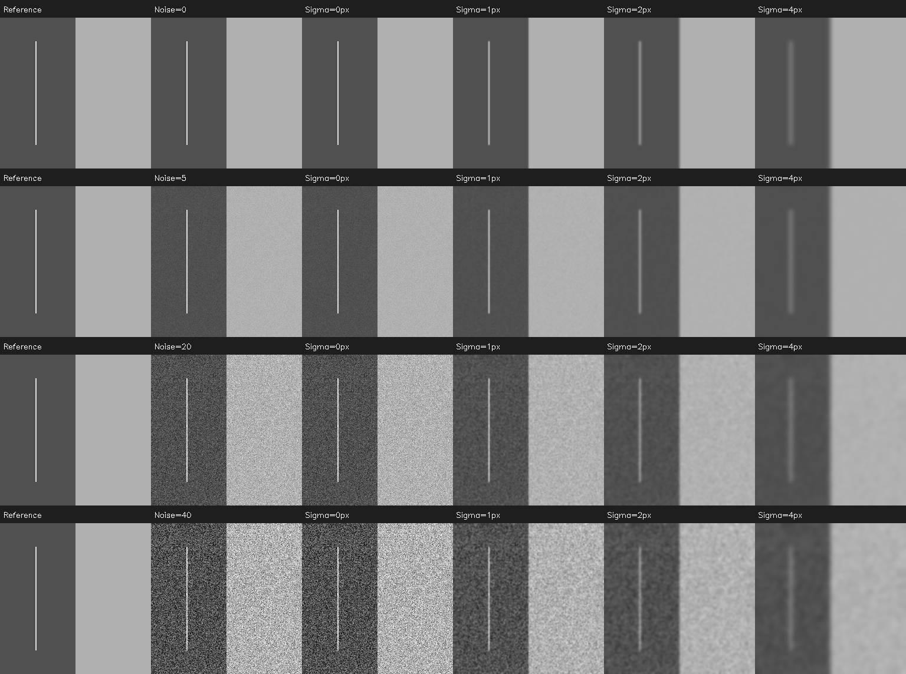

# 가우시안 블러 2.0.0 — OpenCV 전환과 비교 실험

## 범위

담당 B의 가우시안 함수·테스트·실험을 NumPy/OpenCV 기반으로 정리했다.
`image_processing.py`는 RGB PIL 이미지를 받아 같은 크기의 새 RGB PIL 이미지를 반환한다.
내부만 NumPy/OpenCV로 바꾸므로 A의 표시와 C의 저장에서 사용할 입출력 계약은 유지된다.
화면 버튼·저장 연결·ROI 기능·DICOM 읽기는 이번 작업에 포함하지 않는다.
가우시안 하나로 과제의 알고리즘 3개와 ROI 요구가 모두 충족되는 것은 아니다.

## 구현과 설정

가우시안은 가까운 픽셀에 큰 가중치를 주어 노이즈를 줄이며 경계·작은 구조도 흐리게 한다.
이론적 가중치는 `G(x,y) ∝ exp(-(x²+y²)/(2σ²))`이고 합을 1로 정규화한다.

| 항목 | 규칙 |
|---|---|
| API | `gaussian_blur(image, radius=1.0)` |
| 입력 | 기존 로더에서 방향 보정·검증한 비어 있지 않은 RGB PIL 이미지 전체 |
| 출력 | 같은 크기의 새 RGB PIL 이미지, 원본 픽셀 불변 |
| radius | 유한 실수 0~20, 원본 픽셀 단위 표준편차 σ. bool·문자열·NaN·무한대 거절 |
| radius=0 | OpenCV를 호출하지 않고 독립 복사본 반환 |
| 커널 | `k = 2*ceil(3*σ)+1`, x/y 동일한 홀수 크기. σ=1/2/4이면 7/13/25 |
| 경계 | `cv2.BORDER_REFLECT_101`: 경계 픽셀 반복 없이 반사 확장 |
| 처리 | `cv2.GaussianBlur`, `sigmaX=sigmaY=radius` |
| ID / 버전 | `gaussian_blur` / `2.0.0` |

기본값 1 px와 상한 20 px는 구현 제안이며 과제 지정 수치가 아니다.
NumPy로 원본의 RGB `uint8` 배열을 복사하고 OpenCV로 채널별 처리 후 PIL로 반환한다.
블러 자체는 채널 순서에 의존하지 않아 RGB→BGR 전환이 필요 없다.
파일 코덱을 쓰는 실험의 읽기·저장 시에만 BGR↔RGB 변환을 한다.

NumPy 2.2.6 / opencv-python-headless 4.12.0.88 / Pillow 12.3.0을 잠금 파일에 고정했다.
headless 패키지는 Streamlit 서버에 불필요한 별도 GUI 창과 GUI 시스템 의존성을 피하기 위한 선택이다.
의존성이 바뀌었으므로 팀원은 `uv sync --locked`를 다시 실행해야 한다.

## 실행

저장소 루트에서 실행한다. Firebase 계정이나 환자 영상은 필요 없다.

```powershell
uv sync --locked
uv run --locked python -m unittest discover -v
uv run --locked python experiments/gaussian_experiment.py
```

기본 합성 결과는 [gaussian-opencv/synthetic](results/gaussian-opencv/synthetic/)에 저장된다.
기존 [gaussian](results/gaussian/) 폴더는 Pillow 1.0.0 당시의 역사적 결과이며 덮어쓰지 않았다.
다른 위치에 재현하려면 `--output <경로>`를 사용한다.

외부 입력(예: 팀에서 준비한 Lenna)은 다음처럼 별도로 실행할 수 있다.

```powershell
uv run --locked python experiments/gaussian_experiment.py --input "경로/Lenna.png" --color-mode color --output "docs/image-processing/results/gaussian-opencv/lenna-color"
```

`--color-mode grayscale`이면 깨끗한 기준 영상부터 Pillow L로 변환한다.
컬러 모드는 기준 RGB를 유지하고 R/G/B에 독립 잡음을 더한다. 흑백 모드는 밝기 잡음 하나를
RGB 세 채널에 동일하게 복제한다. 기준과 입력의 색상 기준이 일치하므로 색상 소실을 잡음 오차로 오인하지 않는다.
외부 입력은 OpenCV로 읽고 `INTER_AREA`로 256×256 크기로 바꾼다. 종횡비가 다르면 형태가 변하므로
같은 크기 기준의 기초 실험으로만 해석한다. 고비트 입력은 자동으로 8비트 변환하지 않고 거절한다.
**이번에 실제 Lenna 파일로 실행한 것은 아니다.** 외부 입력 경로는 생성한 컬러 fixture로 검증했다.

## 실험 흐름과 계산 기준

1. 입력 읽기: 합성 도형을 PNG로 생성하고 OpenCV로 읽는다. 밝기 80/176 경계와 밝기 224의 2 px 선이다.
2. 노이즈 생성: NumPy `Generator(PCG64(20261115))`로 정규 잡음 σ=0/5/20/40을 만든다.
3. 가우시안 처리: 같은 전체 입력에 radius=0/1/2/4를 독립 적용한다. 이전 결과에 누적하지 않는다.
4. 지표 계산: NumPy 배열 연산으로 아래 지표와 동일 입력의 Pillow 대비 차이를 구한다.
5. 비교 이미지 생성: OpenCV로 제목을 쓰고 NumPy 배열로 4행×6열을 구성한다.
6. CSV·실험 정보 저장: 조건·수치·해시·실행 라이브러리 버전을 저장한다.

노이즈 추가와 픽셀 차이는 먼저 `float64`로 변환해 음수/범위 초과가 `uint8`에서 뒤집히지 않게 한다.
노이즈 추가 후 `np.rint`(정확한 .5는 짝수 쪽 반올림) → 0~255 제한 → uint8 순서다.
이 규칙은 **현재 8비트 PNG 실험 전용**이다.
조건마다 난수 생성기를 동일 시드로 초기화해 같은 표준 잡음 패턴의 크기만 바꾼다.
Python `random.Random`에서 NumPy PCG64로 바뀌었으므로 **시드 숫자가 같아도 1.0.0의 잡음과 다르다.**
고정된 버전·입력·조건에서의 재현성을 확인하며 모든 미래 버전의 바이트 일치까지 보장하지 않는다.

수치 일치와 파일 전체 SHA-256 일치는 다르다. PNG 압축·라이브러리 빌드·환경 정보·줄바꿈이
다르면 픽셀/수치가 같아도 파일 해시는 달라질 수 있다. 이번 동일 환경 재실행에서는 전체 파일
해시도 일치했다. 명세에 OS와 버전을 기록하며 새 실험 텍스트는 UTF-8(BOM 없음),
summary/manifest는 LF, CSV는 CRLF로 고정한다. 과거 Pillow 기록의 줄바꿈은 변경하지 않았다.

| 지표 | 계산과 해석 |
|---|---|
| RMSE | RGB 모든 채널의 `sqrt(mean((result-reference)²))`. 합성 흑백에서는 L과 같은 값 |
| 평탄부 분산 | 합성 영상의 x=[16,48), y=[64,192) L 밝기, `np.var(..., ddof=0)` |
| 경계 대비 | 합성 영상 y=[64,192)에서 L(x=128)−L(x=127)의 평균, 정답 96 |
| 얇은 선 대비 | 같은 y에서 L(x=60,61) 평균−L(x=52)의 평균, 정답 144 |
| Pillow 차이 | **같은 입력·σ**로 Pillow GaussianBlur와 OpenCV 결과의 평균/최대 절대 차이 |

평탄부·경계·선 지표는 합성 도형의 좌표에 의존한다. 외부 영상에는 계산하지 않으며
Lenna의 품질 지표로 해석하지 않는다. 이 고정 실험 영역은 사용자 ROI 구현을 뜻하지 않는다.
분산은 밝기², 나머지는 8비트 밝기 단위다.

## 실제 실행 결과

Python 3.12.14에서 합성 4조건×4강도=16결과를 실행했다.
[실측 표](results/gaussian-opencv/synthetic/summary.md),
[CSV](results/gaussian-opencv/synthetic/metrics.csv),
[환경·해시 명세](results/gaussian-opencv/synthetic/manifest.json)를 함께 제공한다.



잡음 σ=20에서 radius 0→1의 RMSE는 19.951→7.972,
평탄부 분산은 400.556→31.900으로 줄었다. 얇은 선 대비도 142.035→92.219로 약해졌다.
radius 4에서는 선 대비가 26.320으로 낮아지고 RMSE가 10.871로 증가했다.
약한 잡음 σ=5에서는 블러 전 RMSE 4.995가 radius 1에서 5.799로 오히려 증가했다.
노이즈 제거와 세부 보존을 함께 보아야 하며 강도가 클수록 좋은 것은 아니다.

1.0.0의 Pillow 근사에서 명시적 OpenCV 커널·경계로 바뀌어 픽셀은 완전히 같지 않다.
예를 들어 같은 새 잡음 σ=20 입력·radius 1에서 Pillow 대비 평균 절대 차이는 0.569,
최대 차이는 12였다. σ=40·radius 1의 최대 차이는 23이었다.
이 차이는 CSV에서 같은 입력으로 측정했으므로 난수 변경 효과와 분리된다.
버전 간 전체 실험 수치 차이에는 난수 생성기와 처리 구현 변경이 모두 포함된다.

## 테스트와 A/C 연결

현재 브랜치의 전체 자동 테스트 **33개 통과**. B+C 통합 브랜치의 56개 실행 결과와는 별도다.
기존 원본 보존·0 강도 독립 복사·크기·RGB 채널·작은 영상·잘못된 매개변수·뷰어 콜백 검증을 유지했다.
추가로 모서리 임펄스의 알려진 값으로 커널과 Reflect101 경계를 확인하고,
음수 차이 RMSE=255, 시드 재현·클리핑, 컬러 PNG 왕복과 기준 흑백 변환, 16비트 거절을 검증했다.

A는 원본 RGB PIL 복사본과 강도를 전달한다. 표시용 확대·이동은 처리 입력을 바꾸지 않아야 한다.
C는 결과 RGB PIL과 함께 원본 `source_id`, 알고리즘 ID·**2.0.0 버전**, 실제 radius를 저장한다.
재현을 위해 위 커널 산식·경계 규칙은 알고리즘 버전과 함께 고정한다.
배열 반환으로 계약을 바꾸지 않았으므로 화면/저장 코드를 이번에 변경할 필요는 없다.
캐시·처리 이력·ROI 통계 전달 형식의 완성은 별도 통합/ROI PR에서 검증한다.

## 한계와 확장

실제 임상 영상·컬러 잡음의 유용성·최대 입력의 성능/메모리는 검증하지 않았다.
현재 함수는 8비트 RGB 뷰어용 어댑터다. 미래 DICOM의 원본 배열과 자료형을 보존하는 계산은
이 어댑터 및 실험의 반올림/클리핑과 분리해야 한다. pydicom·HU·물리 길이·AI 판정은 추가하지 않았다.

## 근거

- [OpenCV GaussianBlur 공식 문서](https://docs.opencv.org/4.12.0/d4/d86/group__imgproc__filter.html)
- [NumPy Generator와 PCG64](https://numpy.org/doc/2.2/reference/random/generator.html)
- [Pillow GaussianBlur 공식 문서](https://pillow.readthedocs.io/en/stable/reference/ImageFilter.html#PIL.ImageFilter.GaussianBlur)
