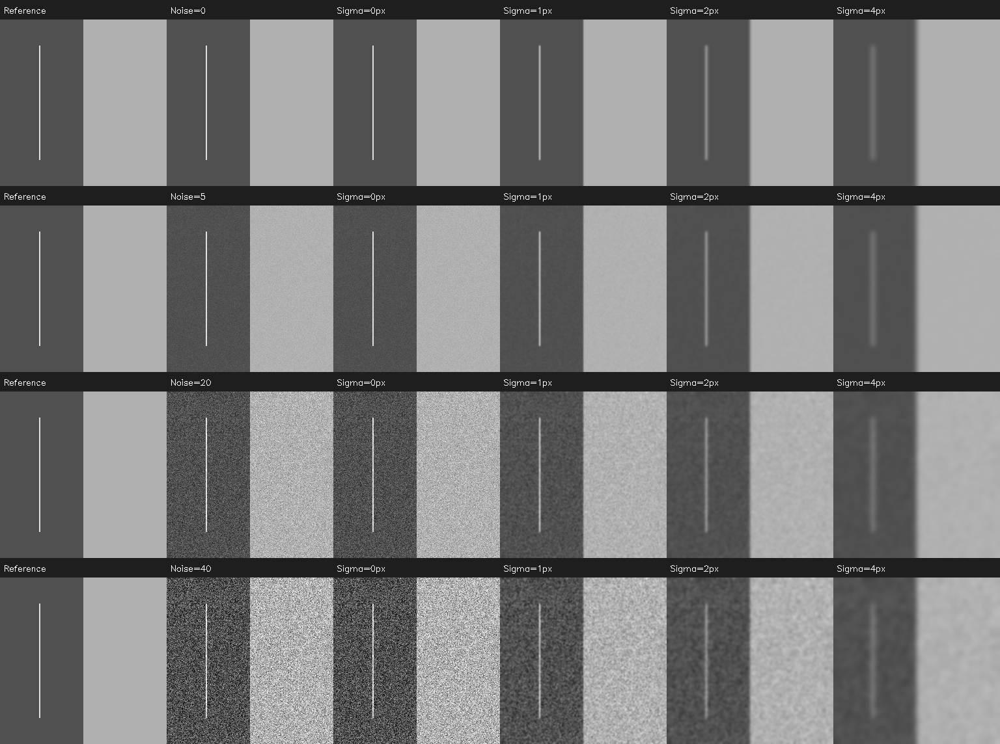
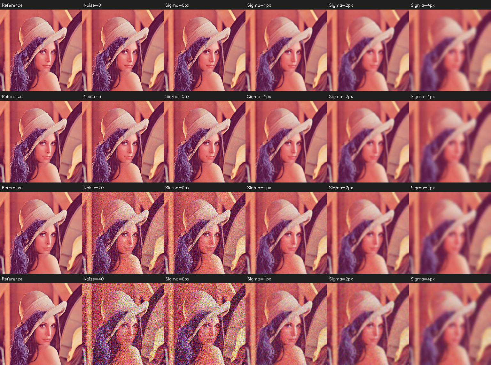

# 가우시안 실험 결과 읽기

처음에는 `comparison.png`로 전체 변화를 보고, `summary.md`와 `metrics.csv`에서 해당 조건의 수치를 확인한다. 실행 환경과 입력은 `manifest.json`을 기준으로 확인한다.

실행 명령은 [최상단 README](../../../README.md), 함수 계약과 계산 기준은 [gaussian.md](../gaussian.md)에서 이어서 볼 수 있다.

## 1. 결과 위치

- [gaussian-opencv/synthetic](gaussian-opencv/synthetic/): OpenCV 2.0.0의 합성 도형 실험. 평탄한 영역, 경계와 얇은 선을 구분해 볼 수 있다.
- [gaussian-opencv/external-color](gaussian-opencv/external-color/): 현재 저장된 Lenna 컬러 실험. 다른 입력으로 같은 기본 명령을 실행하면 이 위치의 결과가 바뀐다.
- `gaussian-opencv/external-grayscale`: 외부 입력을 흑백으로 시험할 때 생성되는 기본 위치. 컬러 실행만으로 생성되지는 않는다.
- [gaussian](gaussian/): 변경 전 Pillow 1.0.0 결과의 보관 위치. 현재 비교판은 Lenna 컬러 기준과 흑백 결과가 섞여 있어 새 컬러 결과와 직접 수치 비교하지 않는다.

## 2. 실행 방법

PACS 최상단 폴더에서 실행한다. 먼저 `uv sync --locked`로 환경을 맞춘다. 이 실험에는 Firebase 계정, `.env`와 웹 서버가 필요 없다.

1. 합성 도형: `uv run --locked python experiments/gaussian_experiment.py`.
2. Lenna 컬러: `uv run --locked python experiments/gaussian_experiment.py --input "./experiments/Lenna.png" --color-mode color`.
3. Lenna 흑백: `uv run --locked python experiments/gaussian_experiment.py --input "./experiments/Lenna.png" --color-mode grayscale`.
4. 옵션 확인: `uv run --locked python experiments/gaussian_experiment.py --help`.

프로젝트 환경을 이미 활성화했다면 `uv run --locked python` 대신 `python`을 사용한다. 예를 들어 `python experiments/gaussian_experiment.py --input "./experiments/Lenna.png"`는 기본 컬러 실험이다. `--input`이 없으면 합성 도형을 사용한다. 입력 파일이 없다면 준비한 다른 8비트 PNG/JPEG의 경로를 지정한다.

같은 출력 위치로 실행하면 이름이 같은 파일을 덮어쓴다. 별도 결과를 보관하려면 명령 끝에 `--output ".local-data/gaussian-lenna-test"`처럼 새 폴더를 지정한다. 다른 외부 입력도 기본 출력 폴더를 공유하므로 파일 이름별 자동 보관으로 오해하지 않는다.

## 3. 비교 이미지 보는 방법

### 합성 도형

이 그림에서는 같은 행에서 잡음 감소와 경계 및 얇은 선의 흐려짐을 함께 읽는다.

### 현재 저장된 Lenna 컬러

이 그림에서는 같은 잡음 입력에 처리 강도만 바꾸었을 때 색상과 세부 구조가 어떻게 달라지는지 읽는다.

비교판은 4행과 6열로 구성된다. 각 칸의 영상은 256×256이며 제목 영역이 별도로 붙는다.

- 행은 위에서부터 잡음 표준편차 0, 5, 20, 40이다. 아래로 갈수록 더 큰 인공 잡음을 준 입력이다.
- 첫 번째 열의 `Reference`는 크기와 색상 처리를 마친 기준 영상이다. 모든 행에서 같은 기준을 반복한다.
- 두 번째 열의 `Noise=...`는 해당 잡음을 더한 입력이다.
- 세 번째부터 여섯 번째 열은 `Sigma=0px`, `Sigma=1px`, `Sigma=2px`, `Sigma=4px`다. 같은 잡음 입력에 각 가우시안 강도를 독립 적용한다.
- `Sigma=0px`는 필터를 적용하지 않은 독립 복사본이므로 같은 행의 잡음 입력과 픽셀이 같다. 잡음 0의 행에서는 기준 영상과도 같다.

가로 방향은 처리 강도를, 세로 방향은 잡음 강도를 바꾼다. 비교할 때는 한 번에 한 방향으로 이동한다. 잡음 표준편차는 8비트 밝기값 단위이고, 필터 표준편차는 원본 픽셀 단위다. 둘 다 표준편차지만 서로 다른 설정이다.

외부 영상은 비율을 유지하지 않고 256×256으로 조정된다. 흑백 모드는 기준부터 밝기 영상으로 변환한다. 따라서 `Reference`를 입력 파일 전체와 같은 바이트 또는 원래 해상도라고 생각하지 않는다.

## 4. 파일별 용도

- `comparison.png`: 한 번에 조건을 비교하는 전체 그림.
- `clean.png`: 크기 조정과 색상 변환을 마친 잡음 없는 기준 영상.
- `synthetic-input.png`: 합성 실험에서 생성한 입력 도형. 외부 입력 실험에는 새로 생성하지 않는다.
- `noise-20.png`: 잡음 강도 20을 준 필터 적용 전 입력. 파일의 숫자는 잡음 강도다.
- `noise-20-radius-1.png`: 잡음 강도 20의 입력에 필터 강도 1을 적용한 결과.
- `summary.md`: 각 조건의 지표를 소수 셋째 자리까지 표시한 요약. GitHub에서 열어 읽을 수 있다.
- `metrics.csv`: 더 자세한 숫자, 원본 입력 ID와 결과 파일 이름. 스프레드시트에서도 열 수 있다.
- `manifest.json`: 알고리즘 버전, 실행 환경, 시드, 색상 모드, 입력과 결과의 해시, 커널과 경계 규칙.

각 실행은 잡음 4조건과 필터 4조건을 조합해 처리 결과 PNG 16개를 만든다. 요약 표의 행도 16개다. 기준 영상과 잡음 입력, 전체 비교판은 이 16개와 별도 파일이다.

## 5. 숫자 읽는 방법

- `noise_sigma`: 입력에 추가한 잡음 강도.
- `radius_px`: 가우시안에 전달한 표준편차. 변수 이름은 radius지만 커널 반지름 자체가 아니다.
- `rmse`: 기준과 결과 사이의 제곱평균제곱근오차(Root Mean Square Error, RMSE). RGB 전체 채널의 차이를 계산한다. 작을수록 이 기준과 가까우며 0이면 픽셀이 같다.
- `flat_variance`: 합성 도형의 평탄한 영역에서 밝기가 얼마나 흔들리는지 나타내는 모집단 분산.
- `step_contrast`: 합성 도형의 밝기 경계 양쪽 차이. 기준은 96이다.
- `thin_line_contrast`: 합성 도형의 얇은 선과 배경의 밝기 차이. 기준은 144다.
- `pillow_difference_mae`와 `pillow_difference_max`: 같은 입력과 필터 강도를 Pillow와 OpenCV로 처리한 두 결과의 평균 및 최대 절대 차이. 기준 영상과의 오차가 아니다.
- `source_id`와 `result_file`: 해당 행을 실제 잡음 입력과 결과 PNG에 연결하는 값.

분산의 단위는 밝기값의 제곱이고, 오차와 대비의 단위는 8비트 밝기값이다. RMSE가 낮다는 것만으로 실제 진단에 적절하다고 판단하지 않는다. 잡음이 줄어도 얇은 구조가 사라질 수 있으므로 그림과 대비 수치를 함께 확인한다.

평탄부, 경계와 얇은 선은 합성 도형의 위치를 알고 측정하는 항목이다. Lenna 같은 외부 영상에는 이 세 지표가 나오지 않는 것이 정상이다. 실험의 고정 영역은 사용자가 그리는 ROI 기능을 뜻하지 않는다.

## 6. 현재 결과에서 읽을 수 있는 예

현재 [Lenna 컬러 CSV](gaussian-opencv/external-color/metrics.csv)의 잡음 20 조건에서 필터 강도 0, 1, 2, 4의 RMSE는 각각 19.725, 9.702, 13.162, 18.893이다. 이 네 조건에서는 강도 1이 기준에 가장 가까웠다. 이것을 모든 영상에서 강도 1이 최적이라는 뜻으로 일반화하지 않는다.

현재 [합성 CSV](gaussian-opencv/synthetic/metrics.csv)의 잡음 20 조건에서는 필터 강도를 0에서 1로 바꾸면 평탄부 분산이 400.556에서 31.900으로 줄지만 얇은 선 대비도 142.035에서 92.219로 낮아진다. 잡음 감소와 구조 손실을 함께 보여 주는 예다.

## 7. 변경 전과 후를 비교할 때

기존 `gaussian` 결과와 새 `gaussian-opencv` 결과는 난수 생성기, 색상 처리, 크기 조정과 오차 계산 기준이 달라 수치를 바로 비교해 구현의 우열을 결정할 수 없다. 같은 시드 번호만으로 입력 픽셀이 같다고 보장하지 않는다. 기존 Lenna 기록의 합성 도형용 구조 지표도 품질 근거로 사용하지 않는다.

구현 변경으로 인한 차이는 현재 CSV의 Pillow 차이 항목을 확인한다. 이 항목은 같은 잡음 입력을 두 구현에 각각 적용하므로 입력 변경의 영향을 분리한다. 차이가 0이 아니라는 사실만으로 오류라고 판정하지 않으며, 어떤 커널과 경계 규칙을 사용했는지 함께 확인한다.

## 8. 재현과 범위

현재 OpenCV 결과의 `manifest.json`은 Python 3.12.16, NumPy 2.2.6, OpenCV 4.12.0, Pillow 12.3.0과 시드 20261115를 기록한다. 다른 환경에서 재실행할 때는 새 명세를 확인한다. 파일 압축과 빌드 차이 때문에 픽셀이 같아도 파일 해시는 달라질 수 있다.

이 실험은 8비트 영상의 필터 동작을 확인한다. AI 학습, 실제 환자의 진단 성능, DICOM 처리, 웹 화면의 처리 버튼과 케이스 저장 연결을 검증하는 실험은 아니다. 외부 입력은 사용과 공유가 허용된 자료인지 확인해 준비한다.
