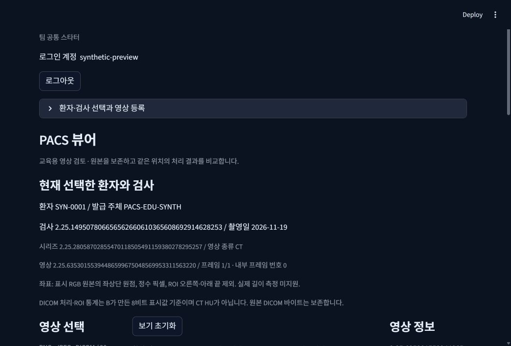
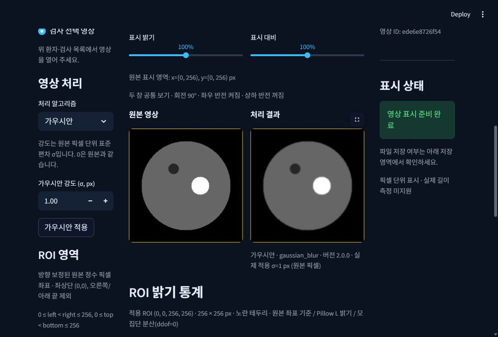
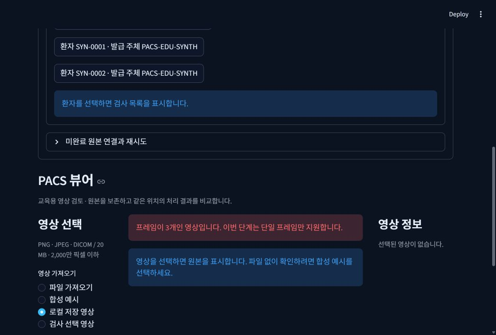

# A 환자·검사 화면과 뷰어 연결

Issue #24, `feature/A-patient-study-ui`의 구현과 확인 기록이다. 첨부된 팀 공유 설계서의 UC01~UC03과 Issue #24의 A01~A37을 기준으로 화면을 연결했다. B의 DICOM 해석과 C의 저장·UID·재시도 로직은 해당 담당자의 함수를 사용한다.

## 브랜치와 검증 범위

- A 기준: `develop`/A 브랜치의 시작 커밋 `d55b347`. 이 브랜치에는 A 화면·상태·뷰어와 시험·문서만 추가했다.
- B 기준: `fbd02e1`, C 기준: `1d7b629`, BC 통합 기준: `bb5932b`.
- A 단독 전체: `python -m unittest discover -v`, **188개 중 182개 통과, 6개 건너뜀**. 건너뛴 6개는 실제 B/C 모듈이 필요한 통합 시험이다. A 화면 시험 20개는 계약 모의 객체를 사용한다.
- BC에 A 변경을 적용한 별도 작업 사본: 같은 명령으로 **307개 모두 통과**. 새 통합 시험 6개는 실제 기본 `app.py`, B 해석기·알고리즘·ROI, C의 등록·조회·재시도와 임시 실제 파일을 사용한다. Firestore HTTP 응답과 인증 세션은 모의 처리한다. 외부 네트워크 호출은 시험에서 차단한다.
- 두 시험 수는 중복되므로 합산하지 않는다. 환경은 Windows, Python 3.12.16, Streamlit 1.55.0, Pillow 12.3.0, NumPy 2.2.6, OpenCV 4.12.0.88이며 BC는 pydicom 3.0.1을 사용한다.

A 단독 체크아웃에는 B/C 모듈이 없으므로 환자·검사 기능을 켜면 서비스 연결 불가를 명시한다. 가짜 환자 저장소를 제품 코드에 넣지 않았다. 실제 기능 실행에는 위 B/C 코드와 함께 연결해야 한다. 통합 작업 사본에서 A의 공통 파일 변경을 패치로 적용해 C가 추가한 `load_image` 입력 타입 검사도 유지했다. A 변경으로 B/C 전체를 A 브랜치에 병합한 것은 아니다.

## 화면 사용 순서

1. 로그인 후 **환자·검사 선택과 영상 등록 → 환자·검사 목록 사용**을 선택한다.
2. 환자 ID와 발급 주체를 확인하고 환자 → 검사 → 시리즈를 선택한다. 검사 날짜가 저장되지 않았으면 미상으로 표시한다. 영상 종류와 부위는 선택 시리즈에서 표시한다.
3. **DICOM 목록** 또는 **PNG/JPEG 목록**을 선택한다. 목록은 현재 불러온 자료만 검색하며 다음 페이지와 새로고침을 제공한다.
4. 영상의 **열기**를 누른 후 **선택 영상 뷰어로 이동**을 사용한다. 현재 환자·검사·시리즈·영상 ID와 날짜·프레임을 뷰어 위에 표시한다.
5. 보기 조절과 B의 영상 처리·ROI를 사용한다. 보기 초기화는 처리·ROI·원본과 선택 정보를 유지한다.
6. 전환 시 미저장 케이스 내용·처리 결과·ROI 또는 검사 상세 수정이 있으면 차단한다. 저장하거나 **미저장 변경 폐기 허용** 후 전환 대상을 다시 선택한다. 이 버튼은 C의 기존 `case_record_discard` 선택을 사용한다.

가상 환자와 검사 생성에는 ID와 발급 주체, 검사 ID를 명시적으로 입력한다. 이름만으로 식별하거나 파일명에서 ID를 발급하지 않는다. 생성 성공과 파일 등록 성공은 따로 안내한다. 식별 누락·충돌이면 입력을 유지하며 보류 사유를 표시한다.

**선택한 검사에 영상 등록**에서 시리즈 ID와 파일을 입력한다. PNG/JPEG는 영상 ID도 입력한다. DICOM의 환자·검사·시리즈 UID는 파일과 선택이 일치해야 한다. 여러 파일의 결과는 입력 순서대로 표시하며 보관만 된 파일을 완료 수에 포함하지 않는다. PNG/JPEG 여러 파일에 같은 영상 ID를 넣었을 때 C의 충돌 검사를 우회해 새 ID를 발급하지 않는다.

**미완료 원본 연결과 재시도**는 사용자·프로젝트에 보관된 요청을 다시 조회한다. 앱을 새로 시작해도 같은 SOP UID 또는 영상 ID와 보관한 바이트로 재시도한다. 다른 환자·새 ID로 바꾸거나 자동 덮어쓰지 않는다. 화면 초기화와 로그아웃은 C의 보관 기록을 삭제하지 않는다.

## 함수와 데이터 계약

| 화면 입력·동작 | 사용한 B/C 계약 |
|---|---|
| 환자 식별·목록·생성 | `PatientIdentity(issuer, patient_id)`, `list_patients`, `save_patient` |
| 검사 선택·생성 | `StudyIdentity(study_id, patient)`, `list_patient_studies`, `save_study` |
| 시리즈 선택 | `Series`, `list_study_series` |
| 원본 목록 | `list_series_images`, `list_series_instances`의 `(items, next_page_token)` |
| PNG/JPEG 등록·열기 | `register_sample_original`의 `RegistrationResult`, `open_selected_original(...).source` |
| DICOM 등록·열기 | `register_dicom_file`, `summarize`, `open_dicom_display(...).source` |
| 미완료 목록·재시도 | B의 `list_pending`·`retry_pending`, C의 `list_pending_links`·`retry_pending_link` |
| 검사 상세 | `get_study_details`, `save_study_details`, 읽은 `update_time`, `StudyDetailsConflict` |

조회 결과가 실패하면 빈 목록으로 바꾸지 않는다. 0건·미선택·검색 0건·권한 403·세션 401·원본 유실·연결 불일치를 구분한다. 페이지 추가 실패는 이전 자료가 최신이 아님을 표시하고 다음 토큰을 유지한다. 상위 대상·원본 종류·프로젝트·사용자 변경 때 하위 선택과 토큰을 정리한다.

검사 상세 충돌은 초안을 유지하고 최신 저장값·수정 버전을 비교하도록 표시한다. 확인된 저장값을 다시 읽으면 뷰어의 촬영일도 갱신한다. 명시적으로 저장된 미상 날짜를 파일 날짜로 임의 대체하지 않는다. 상세 문서가 없을 때만 B가 실제 읽은 DICOM 날짜를 표시할 수 있다. 환자 연결 상태와 수신 상태를 구분하며 파일 등록 성공으로 전체 수신 완료를 만들지 않는다.

## DICOM 표시와 기존 저장 경계

`viewer.load_viewer_source(name, data)`가 일반 파일 입력과 저장 원본 재열기에 공통으로 쓰인다. `.dcm`이면 B의 `load_dicom_source`, 나머지는 기존 `load_image`를 호출한다. `load_image`는 C의 PNG/JPEG 저장 검증에도 쓰이므로 PNG/JPEG 전용 계약을 유지한다. 이 구분은 원본 DICOM 바이트가 기존 저장 코드에서 `.jpg`로 분류되는 것을 방지한다.

- B의 RGB 8비트 표시 영상과 원본 DICOM 바이트를 함께 유지한다. `source_id`는 원본 바이트의 SHA-256이다.
- 현재 20 MB 이하의 비압축 Little Endian, JPEG 2000과 RLE Lossless를 지원한다. 단일 프레임 흑백 CT/MR/CR/DX/Secondary Capture가 대상이다. 지원 밖 압축과 다중 프레임, 컬러 및 표시 변환은 B의 오류를 보여 주며 A가 임의로 변환하지 않는다.
- 화면의 프레임은 1/1, A 내부 `frame_index`는 0이다. 여러 프레임 선택은 지원하지 않는다.
- 좌표는 B가 만든 원래 크기 RGB 영상의 좌상단 원점, 정수 픽셀, 오른쪽·아래 끝 제외다. 확대·크롭·회전·반전은 표시용이다. ROI 통계는 표시값이며 CT HU나 물리 길이가 아니다.
- DICOM은 새 환자·검사 등록 경로로 원본을 보관한다. 기존 PNG/JPEG 케이스·로컬 저장 버튼은 DICOM 원본에 대해 비활성화한다. DICOM 처리 결과·ROI의 케이스 영구 저장은 이번 변경의 지원 범위가 아니다.
- 환자·검사·시리즈·객체 전환 때 C의 정상 전환 정리 후 A의 뷰어 처리·ROI·이전 원본 상태를 정리한다. 실패한 열기는 이전 정상 영상을 표시하지 않는다.

## A01~A37 확인 상태

| 번호 | 확인한 방법과 결과 |
|---|---|
| A01~A05 | A 화면 시험과 실제 C 식별·목록·페이지·원본 열기 통합 시험. 같은 ID/다른 발급 주체 및 같은 합성 이름/다른 PatientID를 구분 |
| A06~A10 | 생성·목록 토큰·검색 범위·오류 구분·촬영일 미상 표시 자동 검사. Chrome에서 실제 C 목록의 CT/MR 선택과 빈 영상 목록 확인 |
| A11~A16 | 일반 업로드·저장 원본 경로를 기본 앱에서 B로 연결해 검사. CT RGB·원본 바이트·해시 확인, 다중 프레임 오류 화면 캡처 |
| A17~A19 | 실제 B/C로 정상·미지원·손상·누락의 파일별 상태 및 집계 확인. A 단독에서는 여섯 결과 상태의 순서와 완료 집계 검사 |
| A20~A23 | 실제 C의 PNG 등록·다시 열기·원본 유실 화면 검사. DICOM의 연결 실패 후 새 AppTest 세션에서 보관된 SOP UID 재시도·재열기. PNG 재시도 ID 전달은 A 계약 시험 |
| A24~A28 | 보기 조절·초기화, 원본/결과/ROI 참조, 미저장 메모·처리·상세 수정 차단, 명시적 폐기, 사용자 변경·로그아웃 자동 검사. Chrome에서 CT 처리·ROI·회전·반전·초기화와 전환 보호 확인 |
| A29~A30 | 상세의 읽은 버전 전달, 충돌 시 입력 보존과 최신값 비교, 날짜 갱신, 연결·수신 상태 분리 자동 검사 |
| A31~A35 | A 실제 기본 앱 진입점의 시험 20개와 실제 B/C 통합 시험 6개, 전체 회귀 검사. 통합의 인증·Firestore만 모의이고 사용자 직접 검수·실서버 검증과 구분 |
| A36 | 에이전트가 Chrome 조작과 아래 캡처를 수행. 사용자·팀원 직접 검수는 대기 |
| A37 | 실제 Firebase 권한·색인, 전체 Linux 앱, 영구 저장 검증은 미완료 |

B/C 호출·프레임·좌표 계약은 Issue #24에 공유했다. 이 문서의 구현·시험 결과는 팀원의 계약 승인이나 병합 승인을 대신하지 않는다.

## Chrome에서 직접 확인한 화면

기본 `app.main()`을 로컬 QA 실행기로 실행했다. QA 실행기만 저장소 밖에 두었고, 실제 A 화면과 B/C 함수를 사용했다. 인증 세션과 Firestore HTTP는 모의, 파일은 가상 사용자 전용 로컬 저장소다. B가 만든 CT/MR/CR 합성 자료와 `EMPTY-0001`의 영상 없는 검사를 사용했다. 실제 Firebase나 임상 자료를 사용한 캡처가 아니다.

1. `SYN-0001 / PACS-EDU-SYNTH` → CT 검사 `2.25.149507806656562660610365608692914628253` → CT 시리즈 → DICOM 객체를 열었다. 촬영일 2026-11-19, CT 256×256, 프레임 1/1과 현재 선택 정보를 확인했다.
2. 가우시안 σ=1, 전체 ROI, 회전 90°, 좌우 반전을 적용했다. 원본/결과 평균 51.401230/51.401169와 모집단 분산 3332.793101/3249.715208을 확인했다. 보기 초기화 후 회전·반전은 기본값이고 두 통계는 유지됐다.
3. MR 검사 전환은 미저장 변경으로 차단됐다. 폐기를 명시적으로 허용한 뒤 MR 선택 정보로 바뀌고 이전 CT 원본·결과가 사라진 것을 확인했다.
4. `EMPTY-0001` → 검사 `1.2.99` → 시리즈 `1.2.99.1`에서 연결 영상 0건 안내를 확인했다.
5. 조회 실패 주입 시 빨간 `request_failed` 안내와 재시도 버튼을 확인했다. 0건 안내는 표시하지 않았다.
6. B의 3프레임 미지원 샘플을 저장 원본 경로에 전달하면 단일 프레임 제한 오류만 표시하고 정상 영상·표시 완료를 만들지 않았다.

## 남은 공동 확인

- B/C 담당자의 호출·좌표·프레임 계약과 공통 `app.py`/`viewer.py` 변경 리뷰
- 사용자·팀원이 위 조작 순서를 직접 실행하는 정성적 검수
- 실제 Firebase의 권한·색인과 등록·조회·재열기 및 사용자 격리
- 전체 Linux 앱과 JCloud 등 영구 보관 환경 검증

할 일과 수정 사항은 Issue #24에, 새 PR의 리뷰 의견과 대응은 그 PR에 남긴다. 종료된 이전 PR/Issue를 다시 열지 않으며 병합은 보류한다.

## ABC 통합의 상세 입력 보존 수정

2026-11-21, `intergrationABC`의 기준 커밋 `640a749`에서 발견한 오류 두 건을 수정했다. A 단독 브랜치의 수정 완료를 뜻하지 않는다.

- 검사 상세를 다시 조회할 때 수정한 초안이 없으면 입력란과 비교 기준도 최신 저장값으로 갱신한다. 수정 중인 초안은 유지하고 최신 저장값과 비교할 수 있다. 저장 성공 후 다시 조회한 값에도 같은 규칙을 적용한다.
- 환자와 검사 목록을 숨겨도 상세 입력의 위젯 상태를 유지한다. 촬영일과 연결 상태, 수신 상태는 재표시 후에도 보존한다. 다른 검사로의 명시적 전환과 로그아웃, 사용자 변경 시 정리는 유지한다.

회귀 시험 7개를 추가했다. 기존 A 화면 계약 시험을 포함한 26개가 통과했고, 실제 C의 상세 저장과 버전 검사 함수를 사용하는 통합 시험도 통과했다. ABC 전체는 **324개 통과, 건너뜀 없음**이다. 인증과 Firestore HTTP는 모의이며, 파일과 B/C 함수는 실제 구현을 사용한다. 외부 네트워크를 차단한 실행기의 상위 프로세스 외부 연결 시도는 0건이었다.

### Lean 4 검증 범위

`verification/lean`에서 Lean 4.36.0과 표준 라이브러리만 사용한다. 총 **25개 모델 명제**를 검사했다. B 8개, C 1개, BC 등록 상태 5개, A 입력 상태 6개, ABC 연결 경계 5개다.

- `ARules.lean`: `patient_study_ui.py`의 재조회와 초안 보존, 버전 일치, 미저장 상세의 선택 전환 규칙이다. 화면을 숨길 때의 보존은 모델의 전제이며 Streamlit AppTest로 실제 동작을 별도로 확인한다.
- `ABCRules.lean`: C와 B의 원본 재열기 및 A의 선택 정보에 대한 식별자 일치와 단일 프레임 조건, `case_processing.py`의 원본 해시 연결, `roi.py`의 정수 영역 조건을 모델링한다.
- 기존 `BRules.lean`, `CRules.lean`, `IntegrationRules.lean`도 다시 검사한다. B의 정수 창 모델은 부동소수점 연산 증명이 아니며, C의 정규화 함수는 매개변수로 둔다.

해당 폴더에서 `lake env lean BRules.lean`, `lake env lean CRules.lean`, `lake env lean IntegrationRules.lean`, `lake env lean ARules.lean`, `lake env lean ABCRules.lean`을 각각 실행한다. 저장소 밖 검증 실행기에서는 잘못된 재조회와 초안 초기화 모델 2개가 거절되는 것도 확인했고, 정수 ROI 5,625개를 실제 Python 검사 함수와 대조했다.

이는 별도 명세 모델의 증명과 유한한 시험이다. Python 프로그램 전체, DICOM 디코더, 파일 바이트의 해시 계산, 실제 Firebase 동작과 전체 Linux 앱을 형식 증명한 것은 아니다. 실제 화면 직접 검수와 실서버 검증은 별도로 남아 있다.

### 다단계 정밀 검증

`StateSequences.lean`에 명제 9개를 추가해 총 34개를 검사했다. 이 단계의 전체 Python 시험은 **327개 통과, 건너뜀 없음**이다. 이번 정밀 검증에서 추가 제품 코드 오류는 발견하지 않았고, 시험과 증명 및 빌드 설정을 보강했다.

- 버전 검사를 통과한 저장은 버전을 전진시키고, 같은 이전 버전을 가진 두 번째 저장은 거절하며 첫 저장값을 보존한다. 원자적인 버전 검사와 쓰기를 저장 경계의 전제로 둔다.
- 화면 숨김과 재표시, 조회 실패로 구성한 임의 길이의 모델 이벤트 목록에서 초안이 유지됨을 귀납법으로 증명했다. 편집과 명시적 폐기, 사용자 변경은 이 목록의 범위가 아니다.
- 수정 중 재조회를 반복해도 초안이 유지되고, 다른 사용자로 바꾸면 이전 사용자의 초안이 남지 않는 모델 규칙을 검사했다.
- 원본 열기와 처리 참조 연결을 합성한 모델에서 선택 식별자와 원본 해시 연결이 유지된다. 식별자가 다르면 처리 연결 전에 거절한다.

`test_lean_correspondence.py`는 실제 A 재조회 함수에 1,024개 입력 상태 조합을 적용한다. 이 중 초안 보존 조회 512개의 Python 관찰값을 별도 Lean 예제로 생성해 검사했다. 실제 C 저장 함수에는 두 작성자의 입력 조합 64개를 순차 충돌 상황으로 적용했다. 이는 동시 서버 부하 시험이나 실제 Firestore 원자성 검증이 아니다. 실제 AppTest에서는 조회 실패, 화면 숨김과 재표시, 재조회 흐름을 세 번 반복한 뒤 사용자 변경 시 초안 정리까지 확인했다.

별도 모델에서 버전 검사 생략, 식별자 검사 생략, 조회 실패 시 초안 초기화, 사용자 변경 시 초안 유출을 각각 주입한 4개 대조 모델은 모두 증명 실패로 거절됐다. 정상 모델에는 미완성 증명이나 사용자 정의 공리를 추가하지 않았다. 공리 출력은 Lean 표준 공리 사용 여부와 구분해 확인한다.

전체 명제는 `verification/lean` 폴더에서 `lake build`로 빌드한다. Python 대조 시험은 저장소 루트에서 `uv run --locked python -m unittest test_lean_correspondence -v`로 실행한다. 관찰 예제 생성기와 잘못된 모델의 대조 로그는 저장소 밖 리뷰 작업 공간에 보관했다.

### 정수 픽셀 기하 확장

`GeometryRules.lean`에 명제 9개를 추가해 총 43개 모델 명제를 검사한다. 좌우 반전 두 번과 상하 반전 두 번, 시계 방향 회전 네 번의 원위치 복원, 회전과 반전 후 좌표 범위, 유효 ROI의 양수 면적과 픽셀 수를 다룬다. 픽셀 수는 행의 수에 대한 귀납법으로 증명한다.

실제 Pillow 변환은 `test_lean_geometry.py`에서 1~5 픽셀 너비와 1~4 픽셀 높이의 합성 영상으로 대조한다. 모든 유효 자르기와 회전 및 반전 11,200개 조합에서 출력 크기와 픽셀 위치, 원본 보존을 확인하고 ROI 700개의 픽셀 수와 크기가 다른 결과 거절도 확인한다. 개별 픽셀 위치 450개를 실제 변환에서 관찰해 Lean 예제로 검사한다. 앞의 재조회 관찰 512개와 합하면 Lean이 검사한 Python 관찰 예제는 962개다.

좌표가 한 픽셀 벗어나도록 회전과 반전 모델을 바꾼 대조 모델 2개도 거절되는지 검사했다. 앞의 4개를 합한 대조 모델은 6개다. 확장 후 전체 Python 시험은 **330개 통과, 건너뜀 없음**이며 추가 제품 코드 오류는 발견하지 않았다. 이 범위는 정수 픽셀 인덱스이며 부동소수점 확대의 모든 입력, 마우스 좌표, 실제 mm 측정과 3D는 포함하지 않는다.

### 입력과 저장 경계 확장

`InputPersistenceRules.lean`에 명제 13개를 추가해 총 56개 모델 명제를 검사했다. 빈 입력과 크기 초과 거절, 양수인 제한값의 정확한 경계 허용, 저장 비트 수 조건과 단일 프레임, 동일 요청의 재시도 불변성 및 다른 내용의 덮어쓰기 방지, 사용자와 프로젝트를 포함한 저장 키의 분리를 다룬다. 저장 모델의 내용은 검증된 직렬화 값으로 추상화하며, JSON 파싱과 해시 충돌 저항성, 파일시스템 및 네트워크 원자성을 증명하지 않는다.

`test_lean_boundaries.py`에서 실제 PNG와 DICOM 함수의 20MB 직전, 경계, 초과 시 디코더 호출 여부를 확인했다. 경계 이하라는 사실은 유효한 영상이라는 뜻이 아니며 이 시험은 크기 검사 순서만 확인한다. 재인코딩한 합성 DICOM의 비트 조건 35개와 프레임 조건 5개, 여섯 등록 상태로 만든 길이 0~4의 배열 1,555개, 처리 결과 참조와 크기 및 모드 54개 조합도 확인했다.

실제 C 등록 함수와 임시 파일 및 SQLite를 사용해 연결 실패 후 재시도, 사용자 및 프로젝트별 미완료 목록 분리, 같은 원본의 반복 재사용, 같은 SOP UID의 다른 원본 거절을 확인했다. 기존 케이스 저장 함수에도 같은 작업 ID의 반복 요청과 다른 내용 충돌을 적용해 저장 문서가 중복되거나 덮어써지지 않는지 확인했다. Firestore 응답은 모의이며 실제 서버 권한이나 동시성 시험이 아니다.

실제 DICOM 비트 조건 관찰 35개를 Lean 예제로 추가해 누적 관찰 예제는 997개다. 크기 경계, 저장 비트 제한, 재시도 덮어쓰기, 사용자 키 분리 규칙을 각각 어긴 모델 4개를 추가해 대조 모델은 10개이며 모두 거절됐다. 확장 후 전체 Python 시험은 **336개 통과, 건너뜀 없음**이다. 제품 코드의 새 오류는 발견하지 않았다.

## 압축 DICOM 지원과 환자 식별 정책

압축 지원은 JPEG 2000 Lossless (`1.2.840.10008.1.2.4.90`), JPEG 2000 (`1.2.840.10008.1.2.4.91`), RLE Lossless (`1.2.840.10008.1.2.5`)로 한정한다. JPEG Baseline과 JPEG-LS 등 다른 전송 구문은 아직 지원하지 않는다. `pylibjpeg==2.1.0`과 `pylibjpeg-openjpeg==2.6.0`을 잠금 파일에 기록했으며 RLE는 pydicom 디코더를 사용한다. 의존성 설치는 `uv sync --locked`로 수행한다.

압축 원본을 압축 해제한 파일로 바꾸어 저장하지 않는다. 디코딩은 표시와 검사에만 사용하고 원본 바이트와 그 SHA-256을 등록과 재시도 및 재열기에서 유지한다. JPEG 2000 헤더의 크기와 채널, 정밀도와 부호를 DICOM 정보와 대조한 뒤 픽셀을 할당한다. 압축 프레임이 여러 개이거나 손상된 경우 정상 영상으로 표시하지 않는다. 디코더 미설치는 미지원 환경으로 안내한다.

무손실 JPEG 2000과 RLE는 합성 CT와 비정사각형 MR, 8비트 MONOCHROME1 및 부호 있는 16비트 자료에서 저장 픽셀을 대조했다. JPEG 2000의 `.91` 전송 구문은 손실 압축을 포함하므로 픽셀의 완전 일치를 보장하지 않는다. 실제 앱 시험은 세 구문의 연결 실패와 재시도, 새 세션 재열기, 가우시안과 ROI까지 확인한다. 인증과 Firestore 응답은 모의이며 실제 환자 자료는 사용하지 않는다.

발급 주체 정책은 팀 공유 통합설계서 `병원영상검사시스템_팀공유_설계서.md`의 UC01과 9.2절, Patient 설명을 따른다. 환자 ID와 발급 주체 또는 허용된 연구 식별 근거로 대상을 확인하고, 근거가 부족하면 연결을 보류한다. 기본 발급 주체를 자동으로 넣거나 이름만으로 병합하지 않는다. 현재 구현에서는 `IssuerOfPatientID`가 없으면 `missing_tag`로 등록을 차단한다. 이는 정상 연결을 방지하는 현재 동작이며, 보류 원본의 영구 보관과 근거 확인 후 연결하는 전용 화면을 구현했다는 뜻은 아니다. 이번 압축 지원으로 이 식별 검사를 완화하지 않았다.

### 최종 검증 요약 (2026-11-21)

압축 지원을 포함한 ABC 전체 자동 시험은 345개 통과, 건너뜀 0개다. 압축 전용 시험 9개도 이 수에 포함한다. 외부 연결을 차단한 실행에서 인증과 Firestore는 모의로 처리했으며 상위 실행기의 외부 연결 시도는 0건이었다. `uv lock --check --offline`, `uv pip check`, `git diff --check`도 통과했다.

Lean 4.36.0의 모델 명제 56개, Python 관찰 예제 997개, 잘못된 규칙을 주입한 대조 모델 10개의 거절을 최종 코드에서 다시 확인했다. Python 전체의 의미적 동등성이나 압축 디코더 구현을 증명한 결과는 아니다. `verification/lean`의 모델은 `lake build`로, Python 대조 시험은 `test_lean_correspondence.py`, `test_lean_geometry.py`, `test_lean_boundaries.py`로 재현한다. 관찰 예제 생성기와 대조 모델 로그는 로컬 리뷰 작업 공간에 있다.

사용자가 올린 합성 자료의 화면 캡처에서는 JPEG 2000 Lossless, RLE Lossless, 손실 JPEG 2000 각각의 원본 표시, 가우시안 σ=1 처리와 전체 ROI 통계를 확인했다. ROI 픽셀 수는 모두 65,536개다.

| 압축 자료 | 원본 평균 | 원본 모집단 분산 | 처리 평균 | 처리 모집단 분산 |
|---|---|---|---|---|
| JPEG 2000 Lossless, RLE Lossless | 51.401230 | 3332.793101 | 51.401169 | 3249.715208 |
| 손실 JPEG 2000 | 51.404724 | 3333.120897 | 51.403625 | 3249.904012 |

이 화면 확인으로 실제 Firebase 등록과 재열기까지 완료 처리하지 않는다. 실제 Firebase 권한과 사용자 격리, Linux 전체 앱, 영구 보관 환경, DICOM 처리 결과와 ROI의 영구 케이스 연결은 별도 검증 또는 구현이 남아 있다. 이번 수정은 `intergrationABC`에만 적용했으며 A 단독과 B 단독, `intergrationBC`의 반영 완료를 뜻하지 않는다.

## 등록 직후 목록 갱신과 DICOM 안내 추가 수정

ABC `bd837f0`에서 아래 두 문제를 실제 앱 회귀 시험으로 재현했다. 원래 코드에서는 새 시리즈가 등록 버튼 동작 직후 목록에 없었고, ROI 적용 후 HU 안내가 두 번 표시됐다. 수정 전 Windows와 WSL에서 새 시험 2개가 모두 실패했고 수정 후 통과했다.

- 등록 요청을 한 번 처리한 뒤 화면을 다시 실행해 이미 앞에서 그린 시리즈와 객체 목록도 즉시 갱신한다. 등록 결과와 파일별 실패 내역은 유지한다. 회귀 시험은 추가 조작 없이 시리즈가 표시되고 실제 등록 함수가 한 번만 호출되는지 검사한다.
- DICOM의 표시값 안내는 뷰어에 한 번만 둔다. ROI를 선택하지 않았을 때와 적용한 뒤 모두 안내를 유지하고 0~255 표시값, HU 등 원본 저장값 및 물리 단위와의 차이, 원본 바이트 보존을 설명한다. 처리 수식이나 통계값은 바꾸지 않았다.

최종 전체 시험은 Windows Python 3.12.16에서 **347개 통과, 건너뜀 0개**이며 외부 연결 시도는 0건이다. 사용자 PC의 WSL Ubuntu 24.04.1과 Python 3.12.3에서는 **347개 중 346개 통과, Windows 전용 경로 시험 1개 건너뜀**이며 외부 연결 시도는 0건이다. WSL에서는 잠금 파일에서 내보낸 해시 고정 의존성을 별도 가상환경에 설치했고 서버 시작, health와 루트 HTTP 200도 확인했다. 인증과 Firestore는 자동 시험에서 모의로 처리한다.

앞선 추가 AppTest 6개는 발급 주체 누락, 다른 검사 충돌, 조회 실패와 복구, 보관 후 연결 실패, 원본 저장 실패와 처리 변경 후 전환 차단을 확인했다. 압축 세 형식은 각각 별도 Linux 프로세스 세 개에서 보관 후 연결 실패, 재시도와 재열기를 확인했다. 저장 파일과 SQLite는 실제 Linux 경로에 두며 Firestore는 JSON 시험 자료다. Windows와 WSL에서 실제 Python 상태와 픽셀 및 비트 관찰값 1,509개가 일치했다.

### 초기 실제 Firebase 읽기 시험의 차단 사항과 후속 해결

아래는 403이 남아 있던 초기 시험 기록이다. 이후 B가 저장소의 규칙을 배포하고 Windows와 WSL에서 실제 등록, 조회, 재시작 후 원본 재열기와 사용자 격리를 확인했다. [Windows 실서버 결과](https://github.com/jjert9070/PACS/issues/36#issuecomment-7056365179), [WSL 실서버 결과](https://github.com/jjert9070/PACS/issues/34#issuecomment-7056683370)를 기준으로 해당 차단은 해결됐다. 운영 저장소의 백업과 복구 완료를 뜻하지 않는다.

별도 읽기 전용 실행기로 실제 테스트 계정 로그인과 인증 프로젝트 일치를 확인했다. 본인 기존 `case_drafts`와 `cases` 목록은 읽을 수 있었고 다른 소유자 케이스 목록 요청은 서버에서 403으로 거절됐다. 그러나 본인 `patients`, `studies`, `series`, `study_images`, `dicom_instances` 목록은 `403 PERMISSION_DENIED`였다.

저장소의 보안 규칙은 해당 경로의 본인 조회를 허용하므로 배포된 규칙이나 다른 서버 정책과의 차이를 확인해야 한다. 원격 규칙을 직접 읽어 대조하지 않았으므로 미배포라고 확정하지 않는다. 실제 문서를 생성하거나 수정 및 삭제하지 않았고 규칙을 배포하거나 권한 검사를 우회하지 않았다. 따라서 실제 Firebase의 신규 환자와 검사 등록 및 재열기 전체는 미완료다.

검증과 수정 내역은 Issue #34에, A와 B 및 C의 연동 검증은 각각 #24, #23, #25에 기록한다. 단독 브랜치의 수정 반영과 별도 시험, 팀원의 직접 검수와 영구 운영 저장소 검증은 구분해 남긴다. `develop` 병합은 하지 않는다.

## 2026-11-21 실제 화면 검증과 검사 상세 저장 충돌 수정

### 실제 화면에서 확인한 동작

VS Code 내장 브라우저의 실제 앱과 Firebase 테스트 계정으로 확인했다. 사용자가 직접 확인한 MR 등록과 원본 재열기와 별도로, 아래 절차는 에이전트가 화면을 조작했다. 전체 팀원의 직접 검수 완료로 간주하지 않는다. 화면 캡처는 검증 대화에 있으며 저장소에 사진을 새로 첨부한 것은 아니다.

1. 합성 환자와 MR 검사를 선택하고 촬영일에 2026-11-19를 입력한다. 검사 상세 저장은 누르지 않는다.
2. 다른 CT 검사를 선택하면 미저장 변경 경고가 나오고 MR 선택을 유지하는지 확인한다.
3. 환자와 검사 목록 사용을 껐다 켜고 상세를 펼친다. 입력한 날짜가 유지되는지 확인한다.
4. 미저장 변경 폐기를 허용한 뒤 CT로 전환하고 MR로 돌아온다. 폐기한 날짜가 되살아나지 않고 기존 저장값이 유지되는지 확인한다.
5. MR 원본을 열고 가우시안 강도 1과 ROI (120, 120, 140, 140)를 적용한다. 원본과 결과 모두 400픽셀, 평균 66.5와 모집단 분산 8.25를 표시한다.
6. 2배 확대의 중앙 영역은 x=[48, 144), y=[40, 120)이며 ROI가 화면 밖이라는 안내가 나온다. 가로와 세로 위치를 각각 100으로 옮기면 x=[96, 192), y=[80, 160)이다.
7. 90도 회전과 좌우 및 상하 반전 뒤 두 영상의 ROI 테두리가 대응하고 원본 좌표와 통계는 유지된다. 보기 초기화는 1배와 위치 50, 회전 0도와 반전 꺼짐으로 돌아간다.
8. 처리 결과가 있는 상태의 검사 전환도 경고로 차단된다. 로그아웃 후 재로그인하면 이전 환자와 검사 선택, 영상과 처리 결과가 남지 않는다.

### 실제 Firebase의 저장 충돌에서 발견한 오류

이전 코드는 검사 상세의 저장 실패 중 HTTP 403, 409, 412에서만 최신 버전을 다시 확인했다. 실제 Firebase는 오래된 updateTime의 저장에 HTTP 400과 "FAILED_PRECONDITION"을 반환했다. 첫 작성자의 값은 보호됐지만 두 번째 앱에서는 일반 요청 실패로 표시되어 최신 값과 초안을 비교하기 어려웠다.

검사 상세 저장 함수가 HTTP 400에서도 기존 저장 버전을 확인하도록 수정했다. 읽은 버전과 서버 버전이 다른 경우에만 충돌로 처리하며, 버전이 같으면 원래 요청 오류를 유지한다. 후속 조회의 권한 거절과 문서 누락을 임의로 충돌로 바꾸지 않는다. 자동 덮어쓰기나 자동 저장 재시도는 추가하지 않았다.

관련 저장 시험 7개는 HTTP 400, 403, 409, 412의 오래된 버전 거절과 최신 값 보호, 변경되지 않은 버전의 일반 오류 유지, 조회 거절 및 누락을 검사한다. 수정 전에는 HTTP 400 관련 두 분기가 실패했고 수정 후 통과했다.

### 실제 서버와 두 독립 앱 세션의 재검증

모의 HTTP 응답 없이 실제 Firebase 로그인과 저장 함수를 사용하는 AppTest 두 세션으로 확인했다. 실제 브라우저 두 창을 동시에 조작한 시험과 구분한다.

- 같은 이전 버전을 읽은 두 세션에서 첫 저장은 성공하고 두 번째 저장은 충돌로 표시됐다.
- 충돌한 세션의 날짜와 환자 연결 상태, 영상 수신 상태 입력을 모두 보존하고 최신 서버 값을 별도로 확인했다.
- 목록을 숨겼다 다시 표시하거나 수정 중 재조회해도 세 입력을 유지했다.
- 변경 없는 재조회는 복구된 서버 값으로 갱신되고, 로그아웃 뒤 재로그인에는 이전 선택과 초안이 남지 않았다.
- 합성 MR 검사만 사용했고 시험 후 상세 필드 값을 기존 기본값으로 복구했다. 처음에는 상세 문서가 없어 기본값 문서를 생성했다. 해당 기본값 문서와 서버 updateTime 변경은 남으며, 삭제하거나 버전을 되돌리지는 않았다. 환자, 검사와 시리즈의 관계 및 원본 파일은 변경하지 않았다.

이번 수정본의 전체 자동 시험은 Windows 349개 통과, WSL Ubuntu 24.04.1에서는 349개 중 348개 통과와 Windows 전용 1개 건너뜀이다. 자동 전체 시험은 외부 연결을 차단했으며 상위 프로세스의 외부 연결 시도는 0건이다. Windows와 WSL에서 수정한 두 Python 파일의 SHA-256도 일치했다. 실제 Firebase AppTest는 별도의 실서버 시험으로 실행했으며 자동 전체 시험 수에 합산하지 않는다.

DICOM 처리 결과와 ROI의 영구 케이스 저장, 보류 원본의 영구 보관과 후속 연결, 운영 저장소의 백업과 복구, A와 C 단독 및 BC 브랜치로의 이번 수정 반영은 여전히 별도다. develop은 병합하지 않는다.

## 2026-11-21 Lean 확장 검증과 케이스 저장 오류 수정

대상은 `intergrationABC`의 `a530530` 위 수정본이다. develop에는 병합하지 않았다.

### 실제 Python 코드에서 재현한 오류

기존 `case_records.save_case`는 작업별 저장 기록이 없다는 이유만으로 HTTP 400과 409를 충돌로 분류했다. 최신 케이스의 버전이 그대로이거나 케이스 자체가 없는 일반 요청 실패도 다른 작성자의 변경으로 안내했다. HTTP 412는 같은 요청의 기존 저장 기록을 확인하는 복구 분기에서 빠져 있었다.

실제 Python 함수에 HTTP 400, 같은 버전과 작업 기록 없음 조건을 적용하자 `CaseConflict`가 발생했다. 그 관찰값을 `StudyRecoveryRules.recover`에 대입한 Lean 예제는 거짓으로 거절됐다. 검사용 모델을 일부러 바꾼 대조 시험과 별도로, 실제 제품 함수의 관찰값에서 불일치를 확인한 것이다.

공통 `save_case` 한 곳에서 다음과 같이 수정했다.

- HTTP 400, 403, 409와 412에서 작업별 불변 저장 기록을 먼저 확인한다.
- 같은 작업과 같은 내용의 저장 기록이 있으면 이전 성공을 확인한다. 내용이 다르면 덮어쓰지 않는다.
- 작업 기록이 없으면 최신 케이스를 확인한다. 최신 버전이 다르거나 새 케이스 ID가 이미 존재할 때만 충돌로 분류한다.
- 최신 케이스도 없거나 버전이 그대로이면 원래 쓰기 오류를 유지한다.
- 후속 조회가 권한 거절이나 통신 오류로 실패하면 해당 조회 오류를 유지한다. 자동 쓰기 재시도는 추가하지 않았다.

추가 케이스 회귀 시험으로 수정 전 오판과 HTTP 412 복구 실패를 재현했고, 수정 후 기존 케이스 시험을 포함한 20개가 통과했다. 실제 서버의 응답을 이번 단계에서 새로 유발한 것은 아니며 HTTP 경계만 모의 처리하고 실제 저장, 조회, 문서 해석 함수를 사용했다. 원본은 합성 PNG와 DICOM, 저장소는 임시 폴더다.

### 확장한 증명과 실제 함수 대조

`StudyRecoveryRules.lean`에 명제 12개를 추가했다. 버전은 정수 순서가 아닌 불투명한 문자열의 일치 여부로 다룬다. 복구 대상 상태의 정확한 범위, 변경 없는 버전의 원래 오류 보존, 오래된 버전의 충돌, 동일 생성 요청의 복구, 다른 내용 거절, 후속 조회 실패를 성공이나 충돌로 오인하지 않는 규칙을 증명했다.

- [x] Lean 4.36.0 전체 모델 9개, 명제 68개 빌드 통과
- [x] 실제 Python 관찰 예제 1,681개를 Lean에서 검사: 상세 재조회 512개, 픽셀 위치 450개, 저장 비트 35개, 상세 저장 복구 468개, 케이스 저장 복구 216개
- [x] 정상 증명에서 `sorry`, `admit`, 사용자 정의 공리와 `sorryAx` 미사용 확인. Lean 표준 공리 사용은 별도로 출력
- [x] 규칙을 일부러 바꾼 검사용 모델 15개 거절 확인
- [x] 실제 Python의 상세 재조회 1,024개 조합, 보기 변환 11,200개 조합과 ROI 700개 기존 대조 시험 재실행
- [x] 추가 상세 저장 회귀 시험 3개: 오류와 버전 및 후속 조회 468개 조합, 필드 값 4,096개 조합, 변조된 조회 문서 72개 조합
- [x] 추가 케이스 저장 회귀 시험 2개: 작업 기록 없는 복구 216개 조합, 네 오류 상태에서 기존 요청 복구와 다른 내용 거절
- [x] Windows 전체 354개 통과, 실패와 건너뜀 0개
- [x] WSL Ubuntu 24.04.1 전체 354개 중 353개 통과, Windows 전용 1개 건너뜀
- [x] 두 전체 시험의 상위 프로세스 외부 연결 시도 0건
- [x] Windows와 WSL의 최상위 Python 및 설정 파일 74개 해시 일치, 직접 의존성 7개 버전 일치
- [x] `uv lock --check --offline`과 `git diff --check` 통과

새 시험 5개가 기존 전체 349개에 추가돼 354개다. 조합 수와 Lean 예제 수는 개별 unittest 수에 더하지 않는다. 검사용 잘못된 모델 15개는 저장소 밖 별도 작업 폴더의 사본이며 제품 코드와 빌드 대상에 넣지 않았다. WSL 잠금 파일의 줄바꿈 차이는 내용이 같은지 확인한 뒤 검증 사본에서만 맞췄다.

일반 빌드는 `verification/lean`에서 `lake build`로 재현한다. 실제 함수 대조 시험은 저장소 루트에서 `python -m unittest test_lean_correspondence test_lean_geometry test_lean_boundaries test_lean_recovery test_lean_case_recovery`로 실행한다. 이번 전체 관찰 예제 생성기와 의도적 오답 모델 및 로그는 로컬 `work/abc-final-expanded-20261121`에 보관했다.

### 증명과 검증의 한계

Lean 결과는 명시한 모델의 증명과 유한한 실제 함수 관찰의 대조다. Python 프로그램 전체의 의미적 동등성, 실제 Firestore의 원자성, 압축 디코더 전체, 파일시스템의 모든 고장 조건과 운영 백업 및 복구를 증명하지 않는다. 작업 기록과 최신 문서는 기존 Python 디코더가 소유자와 식별자를 검증한 값이라는 전제가 있다.

이번 수정은 ABC에만 반영했다. 단독 C와 BC로의 역반영 및 그 브랜치의 재시험은 별도다. DICOM 처리 결과와 ROI 영구 저장, 보류 자료의 영구 보관과 후속 연결, 운영 보관과 복구, 담당자 개인 직접 승인을 완료 처리하지 않는다.
