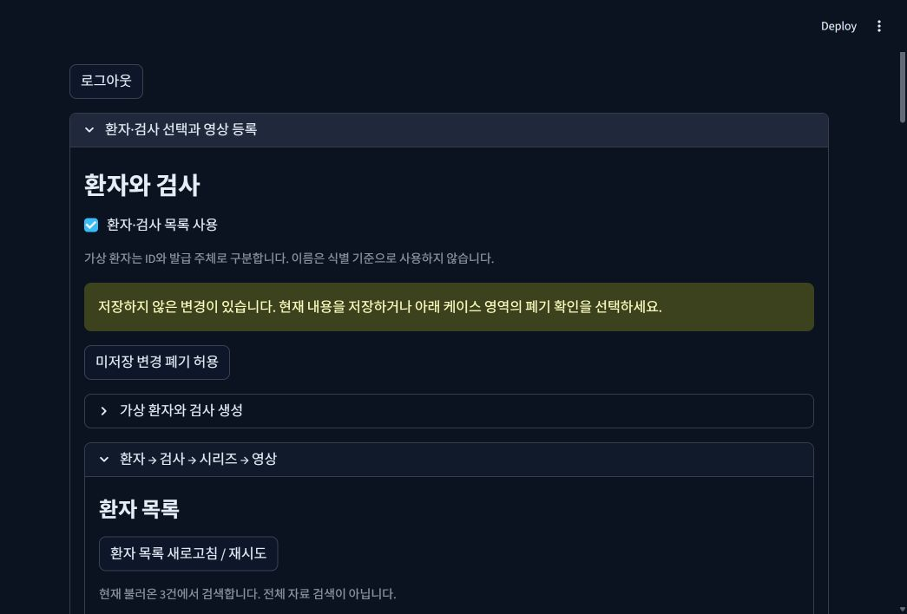
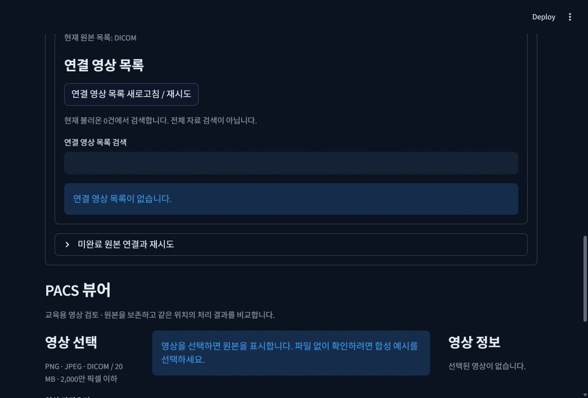
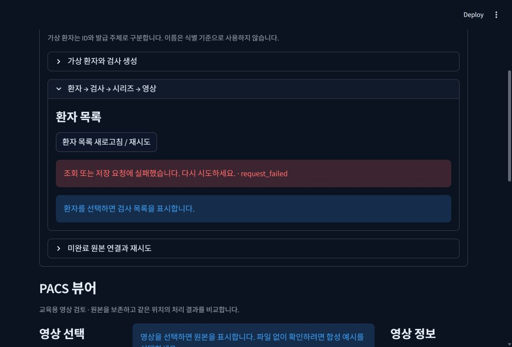

# A 환자·검사 화면과 뷰어 연결

Issue #24, `feature/A-patient-study-ui`의 구현과 확인 기록이다. 첨부된 팀 공유 설계서의 UC01~UC03과 Issue #24의 A01~A37을 기준으로 화면을 연결했다. B의 DICOM 해석과 C의 저장·UID·재시도 로직은 해당 담당자의 함수를 사용한다.

## 브랜치와 검증 범위

- A 기준: `develop`/A 브랜치의 시작 커밋 `d55b347`. 이 브랜치에는 A 화면·상태·뷰어와 시험·문서만 추가했다.
- B 기준: `fbd02e1`, C 기준: `1d7b629`, BC 통합 기준: `bb5932b`.
- A 단독 전체: `python -m unittest discover -v`, **188개 중 182개 통과, 6개 건너뜀**. 건너뛴 6개는 실제 B/C 모듈이 필요한 통합 시험이다. A 화면 시험 20개는 계약 모의 객체를 사용한다.
- BC에 A 변경을 적용한 별도 작업 사본: 같은 명령으로 **307개 모두 통과**. 새 통합 시험 6개는 실제 기본 `app.py`, B 해석기·알고리즘·ROI, C의 등록·조회·재시도와 임시 실제 파일을 사용한다. Firestore HTTP 응답과 인증 세션은 모의 처리한다. 외부 네트워크 호출은 시험에서 차단한다.
- 두 시험 수는 중복되므로 합산하지 않는다. 환경은 Windows, Python 3.12.16, Streamlit 1.55.0, Pillow 12.3.0, NumPy 2.2.6, OpenCV 4.12.0.88이며 BC는 pydicom 3.0.1을 사용한다.

A 단독 체크아웃에는 B/C 모듈이 없으므로 환자·검사 기능을 켜면 서비스 연결 불가를 명시한다. 가짜 환자 저장소를 제품 코드에 넣지 않았다. 실제 기능 실행에는 위 B/C 코드와 함께 연결해야 한다. 통합 작업 사본에서 A의 공통 파일 변경을 패치로 적용해 C가 추가한 `load_image` 입력 타입 검사도 유지했다. A 변경으로 B/C 전체를 A 브랜치에 병합한 것은 아니다.

## 화면 사용 순서

1. 로그인 후 **환자·검사 선택과 영상 등록 → 환자·검사 목록 사용**을 선택한다.
2. 환자 ID와 발급 주체를 확인하고 환자 → 검사 → 시리즈를 선택한다. 검사 날짜가 저장되지 않았으면 미상으로 표시한다. 영상 종류와 부위는 선택 시리즈에서 표시한다.
3. **DICOM 목록** 또는 **PNG/JPEG 목록**을 선택한다. 목록은 현재 불러온 자료만 검색하며 다음 페이지와 새로고침을 제공한다.
4. 영상의 **열기**를 누른 후 **선택 영상 뷰어로 이동**을 사용한다. 현재 환자·검사·시리즈·영상 ID와 날짜·프레임을 뷰어 위에 표시한다.
5. 보기 조절과 B의 영상 처리·ROI를 사용한다. 보기 초기화는 처리·ROI·원본과 선택 정보를 유지한다.
6. 전환 시 미저장 케이스 내용·처리 결과·ROI 또는 검사 상세 수정이 있으면 차단한다. 저장하거나 **미저장 변경 폐기 허용** 후 전환 대상을 다시 선택한다. 이 버튼은 C의 기존 `case_record_discard` 선택을 사용한다.

가상 환자와 검사 생성에는 ID와 발급 주체, 검사 ID를 명시적으로 입력한다. 이름만으로 식별하거나 파일명에서 ID를 발급하지 않는다. 생성 성공과 파일 등록 성공은 따로 안내한다. 식별 누락·충돌이면 입력을 유지하며 보류 사유를 표시한다.

**선택한 검사에 영상 등록**에서 시리즈 ID와 파일을 입력한다. PNG/JPEG는 영상 ID도 입력한다. DICOM의 환자·검사·시리즈 UID는 파일과 선택이 일치해야 한다. 여러 파일의 결과는 입력 순서대로 표시하며 보관만 된 파일을 완료 수에 포함하지 않는다. PNG/JPEG 여러 파일에 같은 영상 ID를 넣었을 때 C의 충돌 검사를 우회해 새 ID를 발급하지 않는다.

**미완료 원본 연결과 재시도**는 사용자·프로젝트에 보관된 요청을 다시 조회한다. 앱을 새로 시작해도 같은 SOP UID 또는 영상 ID와 보관한 바이트로 재시도한다. 다른 환자·새 ID로 바꾸거나 자동 덮어쓰지 않는다. 화면 초기화와 로그아웃은 C의 보관 기록을 삭제하지 않는다.

## 함수와 데이터 계약

| 화면 입력·동작 | 사용한 B/C 계약 |
|---|---|
| 환자 식별·목록·생성 | `PatientIdentity(issuer, patient_id)`, `list_patients`, `save_patient` |
| 검사 선택·생성 | `StudyIdentity(study_id, patient)`, `list_patient_studies`, `save_study` |
| 시리즈 선택 | `Series`, `list_study_series` |
| 원본 목록 | `list_series_images`, `list_series_instances`의 `(items, next_page_token)` |
| PNG/JPEG 등록·열기 | `register_sample_original`의 `RegistrationResult`, `open_selected_original(...).source` |
| DICOM 등록·열기 | `register_dicom_file`, `summarize`, `open_dicom_display(...).source` |
| 미완료 목록·재시도 | B의 `list_pending`·`retry_pending`, C의 `list_pending_links`·`retry_pending_link` |
| 검사 상세 | `get_study_details`, `save_study_details`, 읽은 `update_time`, `StudyDetailsConflict` |

조회 결과가 실패하면 빈 목록으로 바꾸지 않는다. 0건·미선택·검색 0건·권한 403·세션 401·원본 유실·연결 불일치를 구분한다. 페이지 추가 실패는 이전 자료가 최신이 아님을 표시하고 다음 토큰을 유지한다. 상위 대상·원본 종류·프로젝트·사용자 변경 때 하위 선택과 토큰을 정리한다.

검사 상세 충돌은 초안을 유지하고 최신 저장값·수정 버전을 비교하도록 표시한다. 확인된 저장값을 다시 읽으면 뷰어의 촬영일도 갱신한다. 명시적으로 저장된 미상 날짜를 파일 날짜로 임의 대체하지 않는다. 상세 문서가 없을 때만 B가 실제 읽은 DICOM 날짜를 표시할 수 있다. 환자 연결 상태와 수신 상태를 구분하며 파일 등록 성공으로 전체 수신 완료를 만들지 않는다.

## DICOM 표시와 기존 저장 경계

`viewer.load_viewer_source(name, data)`가 일반 파일 입력과 저장 원본 재열기에 공통으로 쓰인다. `.dcm`이면 B의 `load_dicom_source`, 나머지는 기존 `load_image`를 호출한다. `load_image`는 C의 PNG/JPEG 저장 검증에도 쓰이므로 PNG/JPEG 전용 계약을 유지한다. 이 구분은 원본 DICOM 바이트가 기존 저장 코드에서 `.jpg`로 분류되는 것을 방지한다.

- B의 RGB 8비트 표시 영상과 원본 DICOM 바이트를 함께 유지한다. `source_id`는 원본 바이트의 SHA-256이다.
- 현재 20 MB 이하 비압축 Little Endian, 단일 프레임 흑백 CT/MR/CR/DX/Secondary Capture만 표시한다. 지원 밖 압축·다중 프레임·컬러·표시 변환은 B의 오류를 보여 주며 A가 임의로 변환하지 않는다.
- 화면의 프레임은 1/1, A 내부 `frame_index`는 0이다. 여러 프레임 선택은 지원하지 않는다.
- 좌표는 B가 만든 원래 크기 RGB 영상의 좌상단 원점, 정수 픽셀, 오른쪽·아래 끝 제외다. 확대·크롭·회전·반전은 표시용이다. ROI 통계는 표시값이며 CT HU나 물리 길이가 아니다.
- DICOM은 새 환자·검사 등록 경로로 원본을 보관한다. 기존 PNG/JPEG 케이스·로컬 저장 버튼은 DICOM 원본에 대해 비활성화한다. DICOM 처리 결과·ROI의 케이스 영구 저장은 이번 변경의 지원 범위가 아니다.
- 환자·검사·시리즈·객체 전환 때 C의 정상 전환 정리 후 A의 뷰어 처리·ROI·이전 원본 상태를 정리한다. 실패한 열기는 이전 정상 영상을 표시하지 않는다.

## A01~A37 확인 상태

| 번호 | 확인한 방법과 결과 |
|---|---|
| A01~A05 | A 화면 시험과 실제 C 식별·목록·페이지·원본 열기 통합 시험. 같은 ID/다른 발급 주체 및 같은 합성 이름/다른 PatientID를 구분 |
| A06~A10 | 생성·목록 토큰·검색 범위·오류 구분·촬영일 미상 표시 자동 검사. Chrome에서 실제 C 목록의 CT/MR 선택과 빈 영상 목록 확인 |
| A11~A16 | 일반 업로드·저장 원본 경로를 기본 앱에서 B로 연결해 검사. CT RGB·원본 바이트·해시 확인, 다중 프레임 오류 화면 캡처 |
| A17~A19 | 실제 B/C로 정상·미지원·손상·누락의 파일별 상태 및 집계 확인. A 단독에서는 여섯 결과 상태의 순서와 완료 집계 검사 |
| A20~A23 | 실제 C의 PNG 등록·다시 열기·원본 유실 화면 검사. DICOM의 연결 실패 후 새 AppTest 세션에서 보관된 SOP UID 재시도·재열기. PNG 재시도 ID 전달은 A 계약 시험 |
| A24~A28 | 보기 조절·초기화, 원본/결과/ROI 참조, 미저장 메모·처리·상세 수정 차단, 명시적 폐기, 사용자 변경·로그아웃 자동 검사. Chrome에서 CT 처리·ROI·회전·반전·초기화와 전환 보호 확인 |
| A29~A30 | 상세의 읽은 버전 전달, 충돌 시 입력 보존과 최신값 비교, 날짜 갱신, 연결·수신 상태 분리 자동 검사 |
| A31~A35 | A 실제 기본 앱 진입점의 시험 20개와 실제 B/C 통합 시험 6개, 전체 회귀 검사. 통합의 인증·Firestore만 모의이고 사용자 직접 검수·실서버 검증과 구분 |
| A36 | 에이전트가 Chrome 조작과 아래 캡처를 수행. 사용자·팀원 직접 검수는 대기 |
| A37 | 실제 Firebase 권한·색인, 전체 Linux 앱, 영구 저장 검증은 미완료 |

B/C 호출·프레임·좌표 계약은 Issue #24에 공유했다. 이 문서의 구현·시험 결과는 팀원의 계약 승인이나 병합 승인을 대신하지 않는다.

## Chrome에서 직접 확인한 화면

기본 `app.main()`을 로컬 QA 실행기로 실행했다. QA 실행기만 저장소 밖에 두었고, 실제 A 화면과 B/C 함수를 사용했다. 인증 세션과 Firestore HTTP는 모의, 파일은 가상 사용자 전용 로컬 저장소다. B가 만든 CT/MR/CR 합성 자료와 `EMPTY-0001`의 영상 없는 검사를 사용했다. 실제 Firebase나 임상 자료를 사용한 캡처가 아니다.

1. `SYN-0001 / PACS-EDU-SYNTH` → CT 검사 `2.25.149507806656562660610365608692914628253` → CT 시리즈 → DICOM 객체를 열었다. 촬영일 2026-11-19, CT 256×256, 프레임 1/1과 현재 선택 정보를 확인했다.
2. 가우시안 σ=1, 전체 ROI, 회전 90°, 좌우 반전을 적용했다. 원본/결과 평균 51.401230/51.401169와 모집단 분산 3332.793101/3249.715208을 확인했다. 보기 초기화 후 회전·반전은 기본값이고 두 통계는 유지됐다.
3. MR 검사 전환은 미저장 변경으로 차단됐다. 폐기를 명시적으로 허용한 뒤 MR 선택 정보로 바뀌고 이전 CT 원본·결과가 사라진 것을 확인했다.
4. `EMPTY-0001` → 검사 `1.2.99` → 시리즈 `1.2.99.1`에서 연결 영상 0건 안내를 확인했다.
5. 조회 실패 주입 시 빨간 `request_failed` 안내와 재시도 버튼을 확인했다. 0건 안내는 표시하지 않았다.
6. B의 3프레임 미지원 샘플을 저장 원본 경로에 전달하면 단일 프레임 제한 오류만 표시하고 정상 영상·표시 완료를 만들지 않았다.

## 남은 공동 확인

- B/C 담당자의 호출·좌표·프레임 계약과 공통 `app.py`/`viewer.py` 변경 리뷰
- 사용자·팀원이 위 조작 순서를 직접 실행하는 정성적 검수
- 실제 Firebase의 권한·색인과 등록·조회·재열기 및 사용자 격리
- 전체 Linux 앱과 JCloud 등 영구 보관 환경 검증

할 일과 수정 사항은 Issue #24에, 새 PR의 리뷰 의견과 대응은 그 PR에 남긴다. 종료된 이전 PR/Issue를 다시 열지 않으며 병합은 보류한다.
